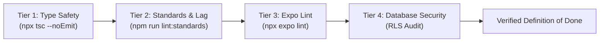

# Testing, Quality Gates & Definition of Done

> **Target Audience:** All AI agents, code reviewers, and software engineers contributing to Chorpy.  
> **Status:** Mandatory. No PR or task may be marked complete without satisfying this protocol.  
> **Standard:** Anthropic SWE-bench & Modern Mobile CI Verification Protocols.

---

## 1. Universal Definition of Done (DoD)

A task, feature, or bugfix is considered **DONE** if and only if all of the following conditions are verifiably satisfied:

1. **Functional Correctness:** The feature functions as specified in its requirements and handles edge-case inputs gracefully.
2. **4-Tier Verification Gate Passed:** All automated static analysis, typechecking, and security checks execute with 0 errors.
3. **Five UI States Implemented:** Any newly created or modified screen handles Empty, Loading, Error, Partial, and Populated states.
4. **Theme Token Adherence:** Colors, typography, and spacing strictly reference tokens from `mobile/src/theme/index.ts`. No raw hex codes are introduced.
5. **Continuous Native Generation Intact:** No manual edits exist in `android/` or `ios/`.
6. **Documentation & Comments Preserved:** Pre-existing architectural docstrings, comments, and types remain undamaged.

---

## 2. The 4-Tier Verification Gate

Before presenting a solution or closing an issue, execute this deterministic 4-tier verification protocol:



### Tier 1: Strict TypeScript Compilation
Ensures type safety across the entire mobile codebase.
```bash
cd mobile && npx tsc --noEmit
```
- **Acceptance Threshold:** 0 errors.
- **Rules:** Never suppress errors with `@ts-ignore` or `any` without an explicit, documented explanation.

### Tier 2: Standards & Lag Audit
Runs the custom deterministic auditor (`audit-rn-standards.js`) checking for UI clichés, performance bottlenecks, and CNG compliance.
```bash
cd mobile && npm run lint:standards
```
- **Acceptance Threshold:** 0 errors.
- **Flags Inspected:**
  - `UI001`: Raw hex colors not imported from `src/theme`.
  - `TP002`: Inline style objects or function allocations inside `.map()` or `renderItem`.
  - `CNG001`: Untracked manual changes to native directories.
  - `DEP001`: Unsafe npm dependencies bypassing Expo.

### Tier 3: Expo Linter
Ensures clean React Native and Expo Router code patterns.
```bash
cd mobile && npx expo lint
```
- **Acceptance Threshold:** 0 critical errors, clean exit.

### Tier 4: Database Security & RLS Validation
Ensures every newly created table in PostgreSQL has active Row Level Security.
- Verify in `database/schema.sql` that:
  ```sql
  ALTER TABLE public.<table_name> ENABLE ROW LEVEL SECURITY;
  ```
- Verify that every table has granular policies defined for `SELECT`, `INSERT`, `UPDATE`, and `DELETE`.

---

## 3. Five-State Edge Case Testing Checklist

Every screen and data-fetching component must be tested against these five operational states before release:

| State | Verification Criteria | Expected Component Behavior |
| :--- | :--- | :--- |
| **1. Empty State** | Zero chores, no paired devices, fresh family circle. | Displays a friendly illustration (*Chorpy*), an encouraging message, and a prominent primary CTA button to create the first chore or pair a device. |
| **2. Loading State** | Initial cold-boot or network query in-flight. | Displays a geometry-matched skeleton layout or centered branded activity indicator. No layout shift (CLS) when data loads. |
| **3. Error State** | Network timeout, Supabase service outage, invalid PIN. | Explains the failure in human-readable terms. Never displays raw stack traces or silent white screens. Provides a direct "Retry" button. |
| **4. Partial State** | Optimistic chore status updates, cached local data. | Reflects user action immediately. If the backend mutation fails, gracefully rolls back the UI state and alerts the user. |
| **5. Populated State** | 1 item, 10 items, 100+ items, extreme string lengths. | Clean scrolling via `FlatList`. Long task titles are defensively truncated (`numberOfLines={1}` or `{2}`). Touch targets remain $\ge 48\text{dp}$. |

---

## 4. Mobile Performance & Lag Prevention Rules

1. **FlatList Optimization:**
   - Always supply `keyExtractor={(item) => item.id}`.
   - For fixed-height list items, provide `getItemLayout` to eliminate dynamic measurement lag.
   - Set `removeClippedSubviews={true}` and sensible `maxToRenderPerBatch` on long lists.
2. **Memoization Discipline:**
   - Do not pass inline anonymous arrow functions `() => doSomething()` into `renderItem` or frequently re-rendered child components; wrap callbacks in `useCallback`.
   - Memoize expensive calculations with `useMemo`.
3. **StyleSheet Hoisting:**
   - Never define inline style objects `style={{ marginTop: 10 }}` inside list render loops. Hoist all styles to `StyleSheet.create`.
