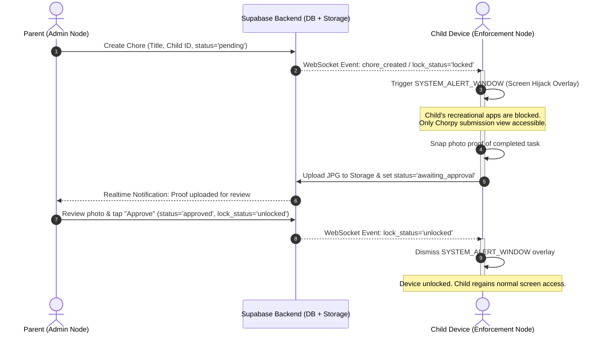
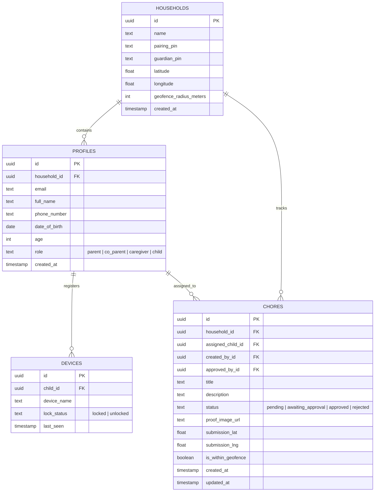

<div align="center">

# CHORPY
### Official System, Development & Architectural Documentation

[](https://reactnative.dev/)
[](https://expo.dev/)
[](https://supabase.com/)
[](https://developer.android.com/)
[](#1-system-implementation-audit--feature-completion-percentage-tracker)
[](https://opensource.org/licenses/MIT)

*This document serves as the single source of truth for the technical specifications, system architecture, database design, functional/non-functional requirements, and development setup for the Chorpy ecosystem.*

> For daily milestone tracking, sprint tasks, and current feature completion status, refer to the [README.md](file:///README.md).

</div>

---

## Table of Contents
1. [System Implementation Audit & Feature Completion Percentage Tracker](#1-system-implementation-audit--feature-completion-percentage-tracker)
2. [Executive Summary & Application Flow](#2-executive-summary)
3. [Problem Statement & Motivation](#3-problem-statement--motivation)
4. [Brand Identity & Mascot System](#4-brand-identity--mascot-system)
5. [System Architecture & Data Flow](#5-system-architecture--data-flow)
6. [Functional Requirements (FR) & Specifications](#6-functional-requirements-fr--specifications)
7. [Role-Based Access Control (RBAC) & Authority Matrix](#7-role-based-access-control-rbac--authority-matrix)
8. [Non-Functional Requirements (NFR)](#8-non-functional-requirements-nfr)
9. [Developer Dual-Workflow (Expo Go vs. Dev Build)](#9-developer-dual-workflow-expo-go-vs-dev-build)
10. [Project Roadmap & Long-Term Vision](#10-project-roadmap--long-term-vision)
11. [Database Schema & Data Models](#11-database-schema--data-models)
12. [Project Directory Structure](#12-project-directory-structure)
13. [Getting Started & Local Setup](#13-getting-started)
14. [Academic Defense Live Demo Walkthrough](#14-academic-defense-live-demo-walkthrough)
15. [Technology Stack](#15-technology-stack)
16. [Installed Dependencies & Packages](#16-installed-dependencies--packages)
17. [Authors & Academic Acknowledgments](#17-authors--academic-acknowledgments)
18. [License](#18-license)

---

## 1. System Implementation Audit & Feature Completion Percentage Tracker

> [!NOTE]
> **Audit Date:** November 13, 2026  
> **Auditor:** Chief of Staff (CoS) Codebase & Specification Audit  
> **Evaluation Scope:** All mobile client components (`mobile/src/`), database schemas & migrations (`database/schema.sql`, `database/queryAdd.sql`), configuration manifests (`mobile/app.json`, `mobile/package.json`), and native services against Functional Requirements **FR-1.1 through FR-6.4**.

### 1.1. High-Level Progress Gauge

```text
Chorpy MVP Functional Implementation: [███████░░░░░░░░░░░░░] 37.00%
Status: Phase 1 Foundation, Onboarding, PIN TTL Security & Chore Management Active
Target Milestone: Academic Capstone Defense MVP
```

### 1.2. Weighted Completion Breakdown

The overall implementation score is calculated as the weighted sum of all functional specification categories and architectural layers:

$$\text{Overall Completion} = \sum (\text{Category Score} \times \text{Weight})$$

| Category | Category Weight | Implementation Score | Weighted Contribution | Status |
| :--- | :---: | :---: | :---: | :---: |
| **FR-1.x:** Account Onboarding & Role Selection | 15% | **90.0%** | 13.50% | `Substantially Implemented` 🟢 |
| **FR-2.x:** Family Circle, Multi-Guardian & RBAC | 15% | **50.0%** | 7.50% | `Partially Implemented` 🟡 |
| **FR-3.x:** Device Permissions & System Handshake | 10% | **0.0%** | 0.00% | `Not Started` ⚪ |
| **FR-4.x:** Chore Creation & Task Management | 15% | **55.0%** | 8.25% | `Partially Implemented` 🟡 |
| **FR-5.x:** Hardware Enforcement & Verification Release | 15% | **15.0%** | 2.25% | `Partially Implemented` 🟡 |
| **FR-6.x:** Geolocation, Geofencing & Life-Safety SOS | 10% | **0.0%** | 0.00% | `Not Started` ⚪ |
| **Database & RLS:** Schema, Triggers, Publications & Storage | 10% | **55.0%** | 5.50% | `Partially Implemented` 🟡 |
| **Native Android:** Modules, Config Plugins & Permissions | 10% | **0.0%** | 0.00% | `Not Started` ⚪ |
| **TOTAL WEIGHTED COMPLETION** | **100%** | — | **37.00%** | **In Active Development** |

---

### 1.3. Detailed Category-by-Category Audit & Codebase Evidence

#### FR-1.x: Account Onboarding & Role Selection (Score: 90%)
- **FR-1.1 (Registration & Ingestion - 95% - Implemented & Verified ✅):** Complete 2-step onboarding pipeline implemented. [`LoginScreen.tsx`](file:///mobile/src/screens/LoginScreen.tsx) (default unauthenticated view) and [`OnboardingScreen.tsx`](file:///mobile/src/screens/OnboardingScreen.tsx) are coordinated by [`AuthScreen.tsx`](file:///mobile/src/screens/AuthScreen.tsx) with transitions (*"Don't have an account? Sign up Here"* / *"Already have an account? Log In Here"*). Step 1 ([`OnboardingStep1Form.tsx`](file:///mobile/src/components/onboarding/OnboardingStep1Form.tsx)) captures full name, email, phone, DOB via [`DobWheelPicker.tsx`](file:///mobile/src/components/onboarding/DobWheelPicker.tsx) (`@react-native-community/datetimepicker` on Android/iOS + virtualized 3-column [`WheelColumn.tsx`](file:///mobile/src/components/onboarding/WheelColumn.tsx) on Web), editable `Age` autofilled from DOB, role, password, and a mandatory Terms & Regulations checkbox. Profile metadata (`fullName`, `phoneNumber`, `dateOfBirth`, `age`, `role`) is ingested via [`authService.signUp()`](file:///mobile/src/services/authService.ts#L16-L33) and mapped by `handle_new_user()` in [`schema.sql`](file:///database/schema.sql#L76-L96). Bootstrap loading and session hydration run in [`AppLoaderScreen.tsx`](file:///mobile/src/screens/AppLoaderScreen.tsx) and [`AuthContext.tsx`](file:///mobile/src/context/AuthContext.tsx).
- **FR-1.1.1 (Dynamic Age Derivation - 100% - Implemented & Verified ✅):** Real-time age calculation implemented in [`calculateAgeFromDOB()`](file:///mobile/src/utils/validation.ts#L150-L213) and paired with editable age bounds (`0–125`) in [`validateAgeInput()`](file:///mobile/src/utils/onboardingValidation.ts#L14-L27) and [`validateStep1Submission()`](file:///mobile/src/utils/onboardingValidation.ts#L39-L78).
- **FR-1.1.2 (Age-Aware Role Recommendation - 100% - Implemented & Verified ✅):** Automatic role adaptation wired in [`OnboardingStep1Form.tsx`](file:///mobile/src/components/onboarding/OnboardingStep1Form.tsx#L47-L48) and [`RoleSelector.tsx`](file:///mobile/src/components/RoleSelector.tsx). If calculated or entered age is under 18, `isParentDisabled` forces `effectiveRole` to `'child'`.
- **FR-1.1.3 (Input Masking & Sanitization - 100% - Implemented & Verified ✅):** Input sanitization implemented in [`validation.ts`](file:///mobile/src/utils/validation.ts):
  - [`formatTitleCase()`](file:///mobile/src/utils/validation.ts#L85-L93): Auto-trims extraneous spaces and title-cases full name inputs on blur.
  - [`formatE164Phone()`](file:///mobile/src/utils/validation.ts#L99-L144): Standardizes Philippine (`09xx` / `9xx`) and North American phone numbers to E.164 international format (`+639...` / `+1...`) with live preview.
- **FR-1.2.1 (Age-Gated Role Authorization - 100% - Implemented & Verified ✅):** Enforced in [`RoleSelector.tsx`](file:///mobile/src/components/RoleSelector.tsx#L22-L49) and [`OnboardingStep1Form.tsx`](file:///mobile/src/components/onboarding/OnboardingStep1Form.tsx#L47-L48). When age `< 18`, the Parent button is disabled, visually dimmed, tagged *"Requires age 18+"*, and submission forces `effectiveRole = 'child'`.
- **FR-1.2.2 (Role Immutability & Hardware Binding - 20%):** Profile role is persisted in PostgreSQL `public.profiles`; physical device hardware binding remains planned for Phase 2.
- **FR-1.3.1 (State-Driven Navigation Routing - 80%):** Implemented in [`App.tsx`](file:///mobile/App.tsx#L68-L171). Unauthenticated users route to [`AuthScreen.tsx`](file:///mobile/src/screens/AuthScreen.tsx); authenticated users route into RBAC-guarded tabs (`HOME`, `MY FAMILY`, `SETTING` for parents; `HOME`, `MY FAMILY`, `CHILD`, `SETTING` for children) starting on [`HomeScreen.tsx`](file:///mobile/src/screens/HomeScreen.tsx). Onboarding Step 2 ([`OnboardingFamilyFork.tsx`](file:///mobile/src/components/onboarding/OnboardingFamilyFork.tsx) with custom `react-native-svg` monoline `KeyIcon` and `FamilyIcon` badges, [`OnboardingJoinPin.tsx`](file:///mobile/src/components/onboarding/OnboardingJoinPin.tsx), [`OnboardingCreateHousehold.tsx`](file:///mobile/src/components/onboarding/OnboardingCreateHousehold.tsx)) is active; hardware permissions wizard routing and automatic lock hijack routing remain planned.
- **FR-1.3.2 (Fail-Closed Offline State Persistence - 0%):** *Not Implemented.* Encrypted lock state caching via `AsyncStorage` and native `BOOT_COMPLETED` receiver remain planned.
- **FR-1.3.3 (Zero-Trust Row Level Security Parity - 45%):** Supabase Auth JWT profile extraction is active in [`authService.getCurrentProfile()`](file:///mobile/src/services/authService.ts#L53-L65) and [`schema.sql`](file:///database/schema.sql#L407-L424) for `profiles` self-read/update and member-scoped `households` `SELECT` (paired with `SECURITY DEFINER` RPCs in [`schema.sql`](file:///database/schema.sql) and [`queryAdd.sql`](file:///database/queryAdd.sql)); multi-tenant `household_id` RLS hardening across `chores` and `devices` remains queued.
- **FR-1.4.1 (Email Format Standardization - 100% - Implemented & Verified ✅):** Validated against RFC 5322 regex via [`validateEmail()`](file:///mobile/src/utils/validation.ts#L41-L53) with inline blur errors in [`LoginScreen.tsx`](file:///mobile/src/screens/LoginScreen.tsx#L23-L30) and [`OnboardingStep1Form.tsx`](file:///mobile/src/components/onboarding/OnboardingStep1Form.tsx#L73-L77).
- **FR-1.4.2 (Password Complexity & Entropy Rules - 100% - Implemented & Verified ✅):** Real-time password entropy scoring implemented in [`evaluatePasswordEntropy()`](file:///mobile/src/utils/validation.ts#L62-L80) and [`PasswordEntropyChips.tsx`](file:///mobile/src/components/PasswordEntropyChips.tsx) enforcing 8+ characters, uppercase, lowercase, and numeric digit criteria.
- **FR-1.5 (Household Intent Gateway - 85%):** Implemented in [`OnboardingScreen.tsx`](file:///mobile/src/screens/OnboardingScreen.tsx#L99-L137) via [`OnboardingFamilyFork.tsx`](file:///mobile/src/components/onboarding/OnboardingFamilyFork.tsx) (featuring `react-native-svg` `KeyIcon` and `FamilyIcon` option cards), [`OnboardingJoinPin.tsx`](file:///mobile/src/components/onboarding/OnboardingJoinPin.tsx), and [`OnboardingCreateHousehold.tsx`](file:///mobile/src/components/onboarding/OnboardingCreateHousehold.tsx). *Gap:* Child accounts are not yet restricted from the Step 2 create-circle branch (`FR-1.5.3`), and dual-PIN generation is pending.

#### FR-2.x: Family Circle Management, Multi-Guardian Pairing & RBAC (Score: 50%)
- **FR-2.1 (Automated Circle Provisioning & 30-Min TTL PIN - 60%):** [`OnboardingCreateHousehold.tsx`](file:///mobile/src/components/onboarding/OnboardingCreateHousehold.tsx) and [`householdService.createHousehold()`](file:///mobile/src/services/householdService.ts#L28-L41) call the `create_household_with_pin` RPC (`allocate_household_pin()`) to generate or reclaim a unique 6-digit `pairing_pin` with a server-authoritative 30-minute `pin_expires_at` TTL (`now() + interval '30 minutes'`) and link the creator's profile.  
  *Gaps:* Dual-PIN architecture (`guardian_pin` column) and persisting `numChildren`/`numCoParents` metadata are not yet added in [`schema.sql`](file:///database/schema.sql#L33-L39).
- **FR-2.2 (Child Circle Pairing & Device Handshake - 65%):** [`OnboardingJoinPin.tsx`](file:///mobile/src/components/onboarding/OnboardingJoinPin.tsx), [`householdService.verifyPin()`](file:///mobile/src/services/householdService.ts#L16-L25), and [`householdService.joinHouseholdWithPin()`](file:///mobile/src/services/householdService.ts#L44-L57) validate 6-digit active PINs (`pin_expires_at > now()`) atomically in PostgreSQL and refresh the profile via [`OnboardingScreen.tsx`](file:///mobile/src/screens/OnboardingScreen.tsx); [`deviceService.registerDevice()`](file:///mobile/src/services/deviceService.ts#L6-L20) exists.  
  *Gaps:* No QR scanner, no 5-attempt/60s rate limiter, and hardware fingerprinting is not yet invoked upon pairing.
- **FR-2.3 (Multi-Guardian Federation & QR Onboarding - 0%):** *Not Implemented.* No QR generator/scanner or secondary guardian role designation screen (`JoinCircleScreen.tsx`).
- **FR-2.4 (Role-Based Access Control for Guardians - 45%):** Client-side RBAC tab navigation and route guard active in [`App.tsx`](file:///mobile/App.tsx#L26-L77), parent-only chore creation gating active in [`MyFamilyScreen.tsx`](file:///mobile/src/screens/MyFamilyScreen.tsx#L101-L125), and server/UI RBAC PIN masking & regeneration active via `get_my_household()`, `regenerate_household_pin()`, and [`HouseholdPinCard.tsx`](file:///mobile/src/components/settings/HouseholdPinCard.tsx).  
  *Gaps:* [`schema.sql`](file:///database/schema.sql#L54) and [`types/index.ts`](file:///mobile/src/types/index.ts#L1) currently define `'parent' | 'child'` only (omitting `'co_parent'` and `'caregiver'`).
- **FR-2.5 (Real-Time Collaborative Approval Sync - 45%):** [`useChores.ts`](file:///mobile/src/hooks/useChores.ts#L83-L97) subscribes to `public.chores` changes filtered by `household_id` and syncs across connected clients; [`MyFamilyScreen.tsx`](file:///mobile/src/screens/MyFamilyScreen.tsx) updates live.  
  *Gaps:* Proof approval UI controls, reviewer attribution (`reviewer_id`), optimistic concurrency locks, and approval toast banners remain planned.
- **FR-2.6 (Live Circle Telemetry Roster - 45%):** [`useHouseholdMembers.ts`](file:///mobile/src/hooks/useHouseholdMembers.ts) loads household profiles for [`ChildMemberPicker.tsx`](file:///mobile/src/components/family/ChildMemberPicker.tsx) and [`ChoreTable.tsx`](file:///mobile/src/components/family/ChoreTable.tsx); [`SettingsScreen.tsx`](file:///mobile/src/screens/SettingsScreen.tsx#L64-L67) embeds [`HouseholdPinCard.tsx`](file:///mobile/src/components/settings/HouseholdPinCard.tsx) for live household name lookup, server-offset 30-min PIN countdown (`getMyHousehold`), and Parent-only PIN regeneration (`regeneratePin`).  
  *Gaps:* Circle name lookup in `MyFamilyScreen.tsx`, live child device lock cards, battery telemetry, and remote override buttons are not yet wired.

#### FR-3.x: Device Permissions & System Handshake (Score: 0%)
- **FR-3.1 (Camera & Media Storage Access - 0%):** `expo-camera` and `expo-media-library` are not installed in [`mobile/package.json`](file:///mobile/package.json#L5-L21). No runtime permission flow exists.
- **FR-3.2 (Geolocation Permissions - 0%):** `expo-location` is not installed; no foreground/background permission prompt exists.
- **FR-3.3 (SYSTEM_ALERT_WINDOW Overlay Inspection - 0%):** No native bridge to query `Settings.canDrawOverlays()`.
- **FR-3.4 (Special App Access Deep-Linking - 0%):** No Android intent dispatch to `android.settings.action.MANAGE_OVERLAY_PERMISSION`.
- **FR-3.5 (Fail-Closed Hardware Gateway - 0%):** `PermissionHandshakeScreen.tsx` does not exist; no anti-revocation observer.

#### FR-4.x: Chore Creation & Task Management (Score: 55%)
- **FR-4.1 & FR-4.2 (Chore Creation & Pending Status - 100% - Implemented & Verified ✅):** Parents tap `"Add Chore"` in [`MyFamilyScreen.tsx`](file:///mobile/src/screens/MyFamilyScreen.tsx#L101-L125) to open [`AddChoreForm.tsx`](file:///mobile/src/components/family/AddChoreForm.tsx), select a child via [`ChildMemberPicker.tsx`](file:///mobile/src/components/family/ChildMemberPicker.tsx) (backed by [`useHouseholdMembers.ts`](file:///mobile/src/hooks/useHouseholdMembers.ts)), and submit sanitized inputs through [`useChores.createChoreOptimistic()`](file:///mobile/src/hooks/useChores.ts#L100-L148) $\rightarrow$ [`choreService.createChore()`](file:///mobile/src/services/choreService.ts#L25-L40) with `'pending'` status, automatic rollback on failure, and virtualized 5-state rendering in [`ChoreTable.tsx`](file:///mobile/src/components/family/ChoreTable.tsx) + [`ChoreRow.tsx`](file:///mobile/src/components/family/ChoreRow.tsx).
- **FR-4.3 (Embedded Camera Viewfinder - 0%):** *Not Implemented.* The *"Take Photo Proof"* button in [`ChildLockScreen.tsx`](file:///mobile/src/screens/ChildLockScreen.tsx#L20-L31) is an unhooked UI placeholder.
- **FR-4.4 (Image Compression & Storage Upload - 0%):** *Not Implemented.* No image resizing and no upload pipeline to Supabase Storage bucket `chore-proofs`.
- **FR-4.5 (Transition to `awaiting_approval` - 50%):** DB mutation logic exists in [`choreService.submitChoreProof()`](file:///mobile/src/services/choreService.ts#L43-L57), but is not yet wired to UI capture controls.
- **FR-4.6 (Collaborative Deduplication & Concurrency Guard - 0%):** *Not Implemented.* No fuzzy string matching, warning modal, single-proof task merging, or multi-task queue bundling yet.

#### FR-5.x: Hardware Device Enforcement & Verification Release (Score: 15%)
- **FR-5.1 (Hardware Screen Hijack & System Overlay - 0%):** *Not Implemented.* No Android native foreground service or `WindowManager` overlay configuration (`TYPE_APPLICATION_OVERLAY`).
- **FR-5.2 (Navigation Trapping & System UI Suppression - 0%):** *Not Implemented.* No hardware back/recent key interception or immersive sticky kiosk mode flags; [`ChildLockScreen.tsx`](file:///mobile/src/screens/ChildLockScreen.tsx) is currently an in-app UI scaffold.
- **FR-5.3 (Real-Time Proof Ingestion - 30%):** Realtime household chore table synchronization is active in [`useChores.ts`](file:///mobile/src/hooks/useChores.ts) and [`ChoreTable.tsx`](file:///mobile/src/components/family/ChoreTable.tsx); photo proof cards and CDN image hydration are not yet built.
- **FR-5.4 (Decision Matrix & Remediation Loop - 25%):** [`choreService.approveChore()`](file:///mobile/src/services/choreService.ts#L60-L80) and [`rejectChore()`](file:///mobile/src/services/choreService.ts#L83-L93) exist in the service layer; guardian approval UI actions in `MyFamilyScreen.tsx` remain planned.
- **FR-5.5 (Hardware Dissolution & Unlock Handshake - 20%):** [`useDeviceLock.ts`](file:///mobile/src/hooks/useDeviceLock.ts#L28-L43) subscribes to `public.devices` updates; wiring to `ChildLockScreen.tsx`, native window teardown, and mascot celebration view remain planned.

#### FR-6.x: Household Geolocation, Geofencing & Life-Safety SOS (Score: 0%)
- **FR-6.1 (Emergency SOS Call Bypass - 0%):** `EmergencySOSButton.tsx` does not exist; no native `tel:911` intent on [`ChildLockScreen.tsx`](file:///mobile/src/screens/ChildLockScreen.tsx).
- **FR-6.2 (Real-Time Panic GPS Broadcast - 0%):** No GPS coordinate sampling; no WebSocket alert broadcast on `household:{household_id}:alerts`; no emergency alert modal on guardian views.
- **FR-6.3 (Haversine Geofenced Chore Verification - 0%):** Distance calculation utility missing; geofence columns missing from `chores` and `households` tables.
- **FR-6.4 (Passive Telemetry & Map Overview - 0%):** `FamilyMapView.tsx` does not exist.

#### Database, RLS & Native Configuration (Score: 55% DB / 0% Native)
- **PostgreSQL Schema (60%):** Core tables (`households`, `profiles`, `devices`, `chores`), `auto_enable_rls` event trigger, `handle_new_user()` trigger (with `date_of_birth` and `age`), `households.pin_expires_at`, partial index `idx_households_active_pin`, 6 `SECURITY DEFINER` PIN TTL RPCs (`allocate_household_pin`, `verify_household_pin`, `create_household_with_pin`, `regenerate_household_pin`, `join_household_with_pin`, `get_my_household`), and `supabase_realtime` publications exist in [`schema.sql`](file:///database/schema.sql) and [`queryAdd.sql`](file:///database/queryAdd.sql), but lack extended columns (`guardian_pin`, `latitude`, `longitude`, `geofence_radius_meters`, `created_by_id`, `approved_by_id`, `submission_lat`, `submission_lng`, `is_within_geofence`).
- **RLS Policies (50%):** Self-only read/update policies exist on `profiles` ([`schema.sql`](file:///database/schema.sql#L407-L413)) and member-scoped `SELECT` exists on `households` ([`schema.sql`](file:///database/schema.sql#L419-L424) & [`queryAdd.sql`](file:///database/queryAdd.sql#L333-L338)), while permissive stubs (`using (true)`) in [`schema.sql`](file:///database/schema.sql#L426-L454) for `chores` and `devices` require multi-tenant `household_id` isolation.
- **Native Android Configuration (0%):** [`app.json`](file:///mobile/app.json#L27-L30) currently configures `"expo-font"` and `"@react-native-community/datetimepicker"`; `SYSTEM_ALERT_WINDOW`, `CAMERA`, `ACCESS_FINE_LOCATION`, and foreground service config plugins remain planned.

---

### 1.4. Implementation Roadmap & Gap Resolution Priorities

```
[Sprint 1: DB & RLS Hardening] ──► [Sprint 2: Proof Review & Live Lock] ──► [Sprint 3: Native Android & Camera] ──► [Sprint 4: Geofence & SOS]
```

1. **Sprint 1 (Database & Security Hardening):**
   - Extend `database/schema.sql` with multi-guardian RBAC roles (`co_parent`, `caregiver`), geofencing columns, and audit identifiers.
   - Replace remaining `using (true)` stubs on `chores` and `devices` with strict multi-tenant RLS policies (`household_id` isolation).
   - Create Supabase Storage bucket `chore-proofs` with authenticated RLS upload rules.
2. **Sprint 2 (Household Live Telemetry & Proof Review UI):**
   - Replace the static circle name placeholder in `MyFamilyScreen.tsx` with live `households` name lookup and add proof review cards (`approveChore` / `rejectChore`).
   - Add collaborative deduplication warning modal in `AddChoreForm.tsx` and restrict Step 2 circle creation for child accounts.
   - Wire `ChildLockScreen.tsx` directly to `useDeviceLock` and `useChores`.
3. **Sprint 3 (Dependencies, Camera & Native Android Modules):**
   - Install `expo-camera`, `expo-location`, `expo-media-library`, and `@react-native-community/netinfo` via `npx expo install`.
   - Build `PermissionHandshakeScreen.tsx` and configure `mobile/app.json` for `SYSTEM_ALERT_WINDOW`, `CAMERA`, `ACCESS_FINE_LOCATION`, and `RECEIVE_BOOT_COMPLETED`.
   - Build native Android config plugin for overlay window management and back-button suppression.
4. **Sprint 4 (Geofencing, Life-Safety SOS & End-to-End Verification):**
   - Implement `EmergencySOSButton.tsx` with `Linking.openURL('tel:911')` and WebSocket panic alert broadcast.
   - Implement Haversine distance verification stamp on photo proof upload.
   - Execute full end-to-end integration validation (`Create -> Lock -> Capture -> Approve -> Unlock`).

---

## 2. Executive Summary

**Chorpy** is an IoT-inspired household chore management and digital wellbeing ecosystem built with **React Native / Expo** and **Supabase**. It bridges the gap between digital screen entertainment and physical domestic responsibilities by establishing a synchronized parent-child device relationship across the household.

Unlike traditional chore charts that are passive and easily ignored, or generic parental control apps that rely on arbitrary timers, Chorpy introduces a **merit-based digital enforcement model**:

1. **The Hook:** Children earn access to their personal devices by completing assigned household chores.
2. **The Lock:** If a mandatory chore is pending, the child's Android device is immediately locked via a hardware-level, non-dismissible screen overlay (`SYSTEM_ALERT_WINDOW`).
3. **The Proof:** To restore screen access, the child captures and submits photo evidence of the completed chore. Once the parent reviews and approves the submission, the lock is instantly dissolved via real-time WebSocket state synchronization.

### 2.1. End-to-End Application Flow

Chorpy structures the household experience into two distinct phases: **Onboarding & Family Circle Setup** followed by the **Daily Chore Enforcement Loop**:

#### Phase 1: Onboarding & Family Circle Setup
1. **Download the App:** Install the Chorpy mobile app on both the Parent and Child devices.
2. **Create Your Account:** Register and authenticate using email and password via Supabase Auth, capturing profile details (Full Name, Phone Number, Date of Birth, and dynamically derived Age).
3. **Select Your Role:** Designate the profile role:
   - **Adult (Admin / Guardian Node):** Choose between establishing a new household (**Primary Parent**) or joining an existing Circle as a secondary guardian (**Co-Parent, Grandparent, or Caregiver/Nanny**).
   - **Child (Enforcement Node):** Restricted node that pairs to the household for chore tracking and device screen enforcement.
4. **Automated Circle Provisioning & Dual-PIN Pairing:**
   - **Primary Parent (Creator):** Automatically provisions a new household Circle upon account registration, generating two distinct codes: a **Child Pairing PIN** and a **Guardian Invite PIN/QR**.
   - **Co-Parents / Caregivers (Dad, Grandma, Nanny):** Enter the **Guardian Invite PIN** to join the existing household without creating duplicate circles, instantly sharing chore management and approval capabilities.
   - **Child:** Enters the **Child Pairing PIN** to pair their physical device with the household Circle.
5. **Enable Device Permissions:**
   - **Camera & Storage Access:** Required for taking and uploading photo evidence of chores.
   - **Location Access:** Enables family circle proximity and location-aware household features.
   - **Display Over Other Apps (`SYSTEM_ALERT_WINDOW`):** *(Child device only)* Required to enforce non-dismissible screen overlays when chores are pending.

#### Phase 2: Daily Chore Lifecycle, Enforcement & Safety Loop
6. **Manage & Assign Chores (The Lock & Concurrency Guard):**
   - An authorized adult (Parent, Co-Parent, or Caregiver) creates a chore. If multiple chores are assigned, they are bundled into a sequential queue (`1 of 2 chores`).
   - If an adult attempts to assign a duplicate task, the concurrency guard prompts them to merge or view the existing chore.
   - In real-time via WebSockets, the child’s Android device freezes behind a full-screen, non-dismissible overlay (`SYSTEM_ALERT_WINDOW`), blocking access to apps and the home screen.
7. **Photo Proof Submitted (The Proof & Geofence Check):**
   - Within the locked overlay, the child accesses the camera, snaps a photo of the completed chore, and submits it.
   - The submission automatically verifies and tags physical presence against the household geofence (`Within Household Perimeter`).
   - The chore status automatically updates to `awaiting_approval`.
8. **Collaborative Verification & Unlock (The Release):**
   - Any authorized adult (Mom, Dad, or Nanny) reviews the photo proof in real time from their dashboard.
   - Tapping **"Approve"** broadcasts an unlock event attributing the reviewer (*"Approved by Dad"*), dissolving the screen overlay on the child's phone in sub-second time.
9. **Emergency SOS Life-Safety Override (The Safety Anchor):**
   - At any moment during active lock enforcement, the child can tap the persistent **"🚨 Emergency SOS"** action to place instant phone calls to parent contacts or `911` and broadcast real-time panic GPS telemetry to all guardian dashboards.

---

## 3. Problem Statement & Motivation

| Traditional Paradigm | The Pain Point | The Chorpy Solution |
| :--- | :--- | :--- |
| **Manual Chore Charts** | Passive, static, and easily ignored; requires continuous verbal nagging from parents. | **Automated Enforcement:** Physical chores are directly tethered to digital privileges. |
| **Time-Quota Screen Limiters** | Imposes arbitrary daily time limits without instilling responsibility or accountability. | **Merit-Driven Access:** Screen time is earned by verifying domestic tasks, not granted passively. |
| **Local-Network Trackers** | Fails on mobile data (4G/5G) or across segmented guest Wi-Fi networks with client isolation. | **Cloud-Synchronized (PIN/QR):** Realtime WebSocket sync via Supabase works across any network or cellular connection. |

---

## 4. Brand Identity & Mascot System

### 4.1. Mascot Persona: "Chorpy the Maya"
The app's mascot is modeled after the **Eurasian Tree Sparrow** (locally recognized across the Philippines as the ***Maya***). Renowned for its energetic morning presence and industrious habit of constantly collecting materials to build and tidy its nest, the Maya perfectly embodies domestic responsibility and active household habits.

To move beyond traditional muted earthy tones into a vibrant, modern tech product aesthetic, Chorpy is stylized in a **Sky Blue & Bright Coral Orange** visual system:

- **Silhouette:** A compact, round, approachable songbird with large expressive eyes designed for high readability at mobile app-icon scale.
- **Cheek Spot:** The iconic cheek patch of the Eurasian Tree Sparrow, reimagined in sharp Slate Navy.
- **Chest & Beak:** A vibrant Coral Orange chest patch and beak that pulse and glow during reward moments and celebratory unlocks.

### 4.2. Color Palette & Design Tokens

Defined canonically in [`mobile/src/theme/index.ts`](file:///mobile/src/theme/index.ts):

| Role | Token Name | Hex Code | Visual Feeling & UI Application |
| :--- | :--- | :--- | :--- |
| **Primary Brand** | `primary` (**Navy Blue**) | `#1B365D` | App headers, active buttons, primary focus states, card titles |
| **Secondary / Accent** | `secondary` / `accent` (**Light Sky / Cyan**) | `#60C1E5` | Call-to-actions, highlights, secondary accents |
| **Success** | `success` | `#16A34A` | Approved chores, unlocked states, validation success |
| **Warning** | `warning` | `#F59E0B` | Pending review badges, caution indicators |
| **Danger** | `danger` | `#DC2626` | Locked/rejected alerts, form errors, sign-out actions |
| **Background** | `background` (**Cloud White**) | `#F8FAFC` | Screen backgrounds and input surfaces |
| **Surface** | `surface` (**Pure White**) | `#FFFFFF` | Cards, forms, navigation headers, table containers |
| **Dark Surface / Text** | `surfaceDark` / `text` (**Slate Navy**) | `#0F172A` | Child Lock Screen dark background (`surfaceDark`) & primary headings (`text`) |

- **Typography:** `Fredoka` (`Fredoka_400Regular`, `Fredoka_600SemiBold`, `Fredoka_700Bold`) for primary display/heading text and `Poppins` (`Poppins_400Regular`, `Poppins_500Medium`, `Poppins_600SemiBold`, `Poppins_700Bold`) for secondary UI copy and labels.

### 4.3. In-App Contextual Mascot States

| App State | Screen / Context | Chorpy's Posture & Visual Cue |
| :--- | :--- | :--- |
| **🔒 Pending / Locked** | Full-Screen Overlay | Chorpy stands guard over a padlock: *"Chores first, screen time later!"* |
| **📸 Photo Submission** | Camera Viewfinder | Chorpy peers through a magnifying glass: *"Snap a clear picture of your work!"* |
| **⏳ Awaiting Review** | Awaiting Approval | Chorpy sips tea beside a timer: *"Sent to parent! Awaiting review..."* |
| **🎉 Approved / Unlocked** | Realtime Unlock Dissolve | Chorpy takes flight with keys in beak amidst confetti: *"All clean! Enjoy screen time!"* |
| **🚨 Emergency SOS** | Lock Screen Emergency Action | Chorpy equipped with a rescue megaphone: *"Help is on the way! Calling family & broadcasting GPS..."* |
| **👨‍👩‍👧 Family Circle** | Circle Members List | Chorpy perched in a stylized nest displaying the household pairing PIN. |

---

## 5. System Architecture & Data Flow

Chorpy operates on a hub-and-spoke real-time architecture connecting two distinct application roles through a managed cloud backend.

```
┌─────────────────────────────────────────────────────────────┐
│             PARENT & GUARDIAN CONTROL NODES                 │
│     (Mom, Dad, Grandparent, Nanny - RBAC Delegated)         │
│  - Task Assignment & Multi-Guardian Scheduling              │
│  - Dual-PIN Household Pairing Generator (Child & Guardian)  │
│  - Collaborative Proof Review & Remote Unlock Commands      │
└──────────────────────────────┬──────────────────────────────┘
                               │ HTTP / WebSocket
                               ▼
┌─────────────────────────────────────────────────────────────┐
│             SUPABASE REALTIME & DATA BACKEND                │
│  - PostgreSQL Database (RLS Policies & Role Management)     │
│  - Realtime WebSocket Engine (Instant State Broadcasting)   │
│  - Supabase Storage (JPG Photo Proof Uploads)               │
└──────────────────────────────▲──────────────────────────────┘
                               │ WebSocket Subscription
                               ▼
┌─────────────────────────────────────────────────────────────┐
│                 CHILD ENFORCEMENT NODE                      │
│            (Android Native / Expo Dev Client)               │
│  - System Overlay Manager (SYSTEM_ALERT_WINDOW Lock)        │
│  - Camera Proof Capture Module                              │
│  - Real-time State Listener (devices table lock_status)     │
└─────────────────────────────────────────────────────────────┘
```

### Core Enforcement & Verification Sequence



---

## 6. Functional Requirements (FR) & Specifications

### 6.1. Account Onboarding & Role Selection
*These requirements define how users establish accounts, ingest verified profile data, and identify their permissions.*
- [x] **FR-1.1 (Account Registration & Profile Ingestion) [COMPLETED ✅]:** The system shall allow a user to register and authenticate an account utilizing an email and password via Supabase Auth, capturing personal profile details (full name, phone number, and date of birth) with intelligent field handling:
  - [x] **FR-1.1.1 (Dynamic Age Derivation) [COMPLETED ✅]:** The user’s age shall be computed automatically in real time from the inputted `date_of_birth`, eliminating redundant manual inputs and temporal data drift.
  - [x] **FR-1.1.2 (Age-Aware Role Recommendation) [COMPLETED ✅]:** The system shall evaluate the calculated age to intelligently suggest or enforce the appropriate role profile (e.g., `< 18` automatically pre-selects/defaults to **Child Node**; `≥ 18` pre-selects **Parent Admin Node**).
  - [x] **FR-1.1.3 (Smart Input Masking & Sanitization) [COMPLETED ✅]:** The phone number field shall feature automatic input masking (standardizing to E.164 international format) and auto-trimming/title-casing for full names.
- **FR-1.2 (Intelligent Role Designation & Anti-Escalation Safeguard):** The system shall require the user to configure their profile role as either a **Parent (Admin Node)** or a **Child (Enforcement Node)**, secured by contextual validation:
  - [x] **FR-1.2.1 (Age-Gated Role Authorization) [COMPLETED ✅]:** If the derived age is under 18, the system shall restrict the selection to a **Child Node** by default; claiming a **Parent Node** shall require administrative verification to prevent unauthorized privilege escalation by minors.
  - **FR-1.2.2 (Role Immutability & Hardware Binding):** Once a profile and its physical device are successfully bound to a household Circle, the assigned role shall be immutable on the local device and can only be modified or revoked by an authenticated Parent Node.
- **FR-1.3 (Adaptive State-Driven Navigation & Fail-Closed Routing):** The system shall deterministically route authenticated users through a state-machine-driven navigation hierarchy based on role, household association, and real-time chore enforcement states:
  - **FR-1.3.1 (Multi-Stage Lifecycle Routing):** The router shall evaluate pre-requisite milestones before rendering primary views:
    1. *Unpaired Adult Profile* $\rightarrow$ Route to **Household Intent Fork Screen** (*"Create New Family Circle"* vs. *"Join Existing Family Circle"*).
    2. *Unpaired Child Profile* $\rightarrow$ Route directly to **Child PIN Entry / QR Scanner Screen** (to connect to the parent's circle).
    3. *Incomplete System Permissions* $\rightarrow$ Route to **Hardware Handshake Wizard** (Overlay, Camera, and Location).
    4. *Verified Adult Node (Owner / Co-Parent / Caregiver)* $\rightarrow$ Route directly to **Parent Command Dashboard** (featuring the auto-generated pairing PINs, real-time device telemetry, chore creation, and proof reviews).
    5. *Child Node (Active / Pending Chores)* $\rightarrow$ Instantly engage the **Non-Dismissible Screen Lock (`SYSTEM_ALERT_WINDOW`)**.
    6. *Child Node (Chores Cleared / Approved)* $\rightarrow$ Route to **Digital Wellbeing Companion View** (displaying earned screen time and chore stats).
  - **FR-1.3.2 (Fail-Closed Offline Enforcement & Anti-Evasion Guard):** The system shall maintain continuous enforcement state resilience across network disconnections, system reboots, and offline environments through local state persistence and fail-closed security logic:
    - **FR-1.3.2.1 (Encrypted On-Device State Persistence):** The mobile client shall persistently cache the active device enforcement state (`'locked'` vs. `'unlocked'`), pending chore identifiers, and last-verified timestamps in secure local storage (`AsyncStorage` / Android Keystore) upon every state transition.
    - **FR-1.3.2.2 (Offline Fail-Closed Default Policy):** If the application launches or detects a total loss of network connectivity (e.g., Airplane Mode or Wi-Fi disconnection), the router shall query the local storage cache; if the last recorded state was `'locked'`, the system shall deterministically engage the `SYSTEM_ALERT_WINDOW` overlay and reject unverified client unlocks.
    - **FR-1.3.2.3 (Android Boot-Time State Restoration):** The native Android module shall register a `BOOT_COMPLETED` broadcast receiver to inspect local persistence immediately upon device power-on, relaunching the locking overlay before background or recreational applications can be accessed.
    - **FR-1.3.2.4 (Network Recovery Auto-Resynchronization):** Upon detection of network restoration (via Android NetInfo / WebSocket reconnection), the client node shall execute an immediate state handshake with the Supabase `devices` table to synchronize pending approvals and dissolve the overlay if an approval occurred while offline.
  - **FR-1.3.3 (Server-Side Authorization Parity & Zero-Trust RLS):** The backend database shall enforce a strict Zero-Trust security model using PostgreSQL Row Level Security (RLS) policies that independently validate every transaction, guaranteeing that client-side UI tampering cannot compromise administrative privileges:
    - **FR-1.3.3.1 (Cryptographic JWT Role Extraction):** Every database query and WebSocket subscription shall cryptographically extract and verify the caller’s user ID (`auth.uid()`) and assigned role from the server-signed Supabase JWT, completely ignoring unverified client-side metadata or parameters.
    - **FR-1.3.3.2 (Mutation Gatekeeping & Privilege Isolation):** PostgreSQL RLS policies shall enforce strict, role-specific mutation gates across database tables (restricting chore approvals and `'unlocked'` device signals exclusively to verified adult roles, while restricting children to proof uploads).
    - **FR-1.3.3.3 (Household Multi-Tenant Boundary Isolation):** All database operations across `chores`, `devices`, and `households` shall enforce a mandatory `household_id` match against the caller's profile, preventing any user from reading or mutating data across different family circles.
    - **FR-1.3.3.4 (Fail-Closed Tamper Rejection):** If a child token attempts to execute an unauthorized administrative mutation, the database engine shall reject the operation immediately via a fail-closed `HTTP 403 Forbidden / RLS Policy Violation`, preventing unauthorized state changes.
- **FR-1.4 (Credential Validation & Policy Enforcement):** The system shall enforce strict client-side and server-side validation rules on authentication credentials prior to account creation and authentication:
  - [x] **FR-1.4.1 (Email Format Standardization) [COMPLETED ✅]:** The system shall validate email address inputs against standard RFC 5322 syntax (requiring a valid recipient name, an `@` symbol, and a top-level domain e.g., `user@domain.com`), rejecting malformed submissions with immediate inline error feedback.
  - [x] **FR-1.4.2 (Password Complexity & Entropy Rules) [COMPLETED ✅]:** The system shall require passwords to be at least eight (8) characters in length and enforce a composition policy containing at least one uppercase letter (`A-Z`), one lowercase letter (`a-z`), and one numeric digit (`0-9`), accompanied by visual real-time requirement feedback as the user types.
- **FR-1.5 (Household Intent Gateway: Creation vs. Federation):** Prior to accessing primary system features, the system shall intercept authenticated adult users at a dedicated onboarding gateway (`HouseholdForkScreen.tsx`) to declare their circle association intent:
  - **FR-1.5.1 (Circle Creation Pathway - Primary Parent):** Selecting *"Create a New Circle"* designates the user as the Primary Parent / Circle Owner, triggers zero-click automated circle provisioning, generates the dual-PIN pairing keys (Child & Guardian), and routes directly to the dashboard.
  - **FR-1.5.2 (Circle Federation Pathway - Secondary Adult):** Selecting *"Join an Existing Circle"* routes the adult to the `JoinCircleScreen.tsx` to enter the Guardian Invite PIN or scan the Primary Parent's QR code, binding them to the existing household as Co-Parent or Caregiver without fragmenting into duplicate circles.
  - **FR-1.5.3 (Child Node Pathway Restriction):** Accounts verified as children (`role = 'child'`) shall be strictly restricted from circle creation pathways and routed directly to the Child PIN / QR pairing gateway.

### 6.2. Family Circle Management, Multi-Guardian Pairing & RBAC
*These requirements govern the automated establishment, multi-guardian federation, and role-based permissions across household accounts.*
- **FR-2.1 (Zero-Click Automated Household Circle Provisioning):** The system shall automatically provision a new household Circle for an initial parent account immediately upon successful registration and role designation:
  - **FR-2.1.1 (Dual-PIN Architecture Generation):** The system shall generate two distinct, cryptographically collision-free codes for each household: a **Child Pairing PIN** (for device enforcement binding) and a **Guardian Invite PIN / QR code** (for secondary adult onboarding).
  - **FR-2.1.2 (Instant Admin Binding & Zero-Friction Routing):** The system shall immediately link the registering parent as the Circle Owner/Admin and bypass manual household forms, directly routing them to the Parent Dashboard with pairing codes ready for distribution.
- **FR-2.2 (Child Circle Pairing & Device Hardware Handshake):** The system shall guide the child user through a friction-free, secure household onboarding and device registration process:
  - **FR-2.2.1 (Child-Friendly PIN Entry UX & QR Scanner):** The interface shall present an intuitive 6-digit input mechanism featuring automatic digit focus advancement, numeric keypad enforcement, auto-submission upon 6th digit entry, and an optional 1-tap QR code camera scanner to eliminate typing friction for younger children.
  - **FR-2.2.2 (Rate-Limited Validation & Anti-Guessing Guard):** The system shall validate entered PINs against active household records, enforcing a rate-limiting cooldown (maximum 5 failed attempts triggering a 60-second cooldown) accompanied by visual and haptic error feedback to prevent brute-force guessing.
  - **FR-2.2.3 (Hardware Fingerprint & Telemetry Ingestion):** Upon successful PIN validation, the client shall automatically extract and register physical device telemetry (manufacturer, hardware model e.g., *"Samsung A12"*, Android OS version, and unique client installation identifier) into the `public.devices` table, permanently binding the physical device to the child profile.
  - **FR-2.2.4 (Automated Transition to Permissions Wizard):** Immediately upon successful pairing confirmation, the system shall render a celebratory welcome cue from the Chorpy mascot and automatically route the child into the mandatory **Hardware Permissions Handshake** (Overlay, Camera, and Location).
- **FR-2.3 (Multi-Guardian Household Federation & QR Onboarding):** The system shall enable secondary adult users (Co-Parent, Grandparent, Caregiver/Nanny) to federate into an existing household Circle without creating fragmented duplicate accounts, guided by explicit UI screens:
  - **FR-2.3.1 (Primary Parent QR & PIN Presentation Hub):** The Primary Parent dashboard (`ParentDashboard.tsx` $\rightarrow$ `CircleSettingsModal`) shall provide an accessible management card that dynamically generates a high-contrast QR code (encoding household ID and guardian PIN) alongside a copyable 6-digit Guardian Invite PIN with native mobile share-sheet integration (SMS, WhatsApp, or clipboard).
  - **FR-2.3.2 (Secondary Adult Dual-Mode Pairing Screen):** During onboarding (`JoinCircleScreen.tsx`), the secondary adult shall be provided dual-mode verification: an embedded camera viewfinder to scan the parent's QR code in one tap, or a manual 6-digit PIN input fallback.
  - **FR-2.3.3 (Caregiver Relationship & Role Selection):** Upon successful PIN or QR resolution, the secondary adult shall designate their specific domestic relation via an in-app selector (*"Co-Parent"*, *"Grandparent"*, or *"Caregiver/Nanny"*), automatically provisioning the corresponding RBAC tier in `public.profiles`.
  - **FR-2.3.4 (Bidirectional WebSocket Roster Sync):** Successful guardian pairing shall trigger an immediate Supabase Realtime broadcast to all active circle administrators, updating the household member roster with an affirmative banner (*"John Doe joined as Co-Parent"*) and granting instant shared access to chore management and device telemetries.
- **FR-2.4 (Role-Based Access Control - RBAC for Guardians):** The system shall enforce tiered permissions among adult household members as defined in Section 7, preventing unauthorized privilege escalation and protecting administrative settings:
  - **FR-2.4.1 (Database-Level Role Enforcement):** User session tokens shall be checked against PostgreSQL Row Level Security (RLS) policies mapping to `public.profiles.role` (`'parent'`, `'co_parent'`, `'caregiver'`), rejecting unauthorized API mutations at the database level.
  - **FR-2.4.2 (Owner-Exclusive Administrative Safeguards):** Destructive actions—such as deleting the household circle, regenerating the master Guardian PIN, or removing adult members—shall be restricted exclusively to the Primary Parent (Owner).
  - **FR-2.4.3 (Delegated Caregiver Task Boundary):** Secondary caregivers and nannies shall have operational permissions to assign everyday chores, review submissions, and release locks, but shall be strictly restricted from viewing family billing or modifying household geofence boundaries.
  - **FR-2.4.4 (Dynamic UI Permission Adaptation):** The mobile client interface (`ParentDashboard.tsx`) shall dynamically evaluate the user's role and conditionally render administrative controls, hiding restricted action buttons from caregiver and co-parent views.
- **FR-2.5 (Real-Time Collaborative Approval Synchronization):** The system shall synchronize chore review actions across all connected adult devices via WebSockets, eliminating duplicate reviews and state conflicts:
  - **FR-2.5.1 (Instant Multi-Guardian Broadcast):** When an adult approves or rejects a chore, Supabase Realtime shall broadcast an event payload containing `chore_id`, updated `status`, `reviewer_id`, `reviewer_name`, and timestamp across the household channel.
  - **FR-2.5.2 (Audit Attribution & Toast Notification):** All active guardian dashboards shall immediately display a non-intrusive toast alert attributing the action (e.g., *"Dishes approved by Dad (John)"*), updating the chore card state without requiring a manual pull-to-refresh.
  - **FR-2.5.3 (Optimistic Concurrency & Collision Lockout):** If multiple guardians inspect the same submission simultaneously, the first approval transaction shall lock the chore and disable review actions on other screens with an inline badge (*"Already Approved by Dad"*), preventing conflicting decisions.
  - **FR-2.5.4 (Downstream Device Unlock Trigger):** Upon verification approval, the system shall immediately update the target child’s record in `public.devices` to `'unlocked'`, transmitting the release signal to the child device within 500 ms.
- **FR-2.6 (Live Circle Telemetry Roster & Remote Controls):** The system shall maintain an interactive, real-time family telemetry overview accessible on the parent dashboard:
  - **FR-2.6.1 (Child Node Health & Heartbeat Cards):** The dashboard shall render a dedicated card for each connected child device displaying the assigned child's name, hardware model, current lock state (`Locked` vs. `Unlocked`), battery level percentage, and last-seen heartbeat timestamp (`last_seen`).
  - **FR-2.6.2 (Active Guardian Roster Display):** The dashboard shall provide a members sheet displaying all connected adults, their designated relationship badges (Owner, Co-Parent, Caregiver), and their current real-time online status.
  - **FR-2.6.3 (Automated WebSocket State Telemetry):** The roster view shall subscribe to real-time changes on `public.devices` and `public.profiles`, automatically reflecting changes in battery status, device lock transitions, and member additions without page reloads.
  - **FR-2.6.4 (1-Tap Emergency Remote Override):** Primary Parents and Co-Parents shall have access to emergency override controls directly on each child card (e.g., *"Force Unlock for 30 Mins"* or *"Instant Emergency Lock"*).

#### 6.2.1. Household Pairing PIN 30-Minute TTL & Reclamation Specification

To prevent indefinite exposure of static household invitation codes and eliminate `pairing_pin` `UNIQUE` collisions over time, Chorpy enforces a **30-minute Time-To-Live (TTL)** invitation lifecycle anchored strictly on PostgreSQL server time (`now()`):

1. **Server-Authoritative Expiration (`pin_expires_at`):**
   - Whenever a Parent creates a household (`create_household_with_pin`) or regenerates an invitation code (`regenerate_household_pin`), the database sets `pin_expires_at = now() + interval '30 minutes'`.
   - All PIN validity checks (`verify_household_pin` and `join_household_with_pin`) evaluate `pin_expires_at > now()` inside PostgreSQL so device clock rollbacks cannot extend an expired PIN.
   - Pre-existing household rows with `pin_expires_at IS NULL` are treated as expired until a Parent taps **Regenerate PIN**.
2. **Atomic Collision Check & Expired-PIN Reclamation (`allocate_household_pin()`):**
   - `public.households.pairing_pin` is nullable while preserving its `UNIQUE` constraint and partial index `idx_households_active_pin` (`WHERE pairing_pin IS NOT NULL`).
   - Before assigning a generated 6-digit candidate PIN (`100000`–`999999`), `allocate_household_pin()` locks any matching row (`FOR UPDATE`):
     - If unused, the candidate PIN is immediately issued.
     - If already assigned to another household whose `pin_expires_at IS NULL OR pin_expires_at <= now()`, that stale household's `pairing_pin` and `pin_expires_at` are atomically cleared to `NULL`, reclaiming the PIN exclusively for the new or regenerating household.
     - If actively held by another household (`pin_expires_at > now()`), the allocator retries up to 15 candidates.
3. **Zero-Trust `SECURITY DEFINER` RPCs & Tightened RLS:**
   - Permissive `using (true)` / `with check (true)` policies on `public.households` are replaced by member-scoped `SELECT` RLS (`id = (SELECT household_id FROM public.profiles WHERE id = auth.uid())`).
   - All household creation, verification, joining, fetching, and PIN regeneration execute via hardened `SECURITY DEFINER` RPCs (`SET search_path = public`): `verify_household_pin`, `create_household_with_pin`, `regenerate_household_pin`, `join_household_with_pin`, and `get_my_household`.
4. **RBAC Live PIN & Skew-Safe Countdown (`HouseholdPinCard.tsx`):**
   - **Parent (`role === 'parent'`):** Sees the live 6-digit PIN, a server-clock-offset-calibrated `MM:SS` countdown (`Date.parse(server_now) - Date.now()`), and the **Regenerate PIN** action button.
   - **Child (`role === 'child'`):** Sees household name and sync status only; `pairing_pin` and `pin_expires_at` are masked server-side (`null`), rendering `"Parent Only"` with the **Regenerate PIN** control hidden.

### 6.3. Device Permissions & System Handshake
*These requirements ensure mandatory hardware and OS-level capabilities are verified before enforcement.*
- **FR-3.1 (Camera & Media Storage Access for Verification Proof):** The system shall manage hardware camera and storage permissions on `PermissionHandshakeScreen.tsx` to support verifiable domestic chore submissions:
  - **FR-3.1.1 (Runtime Camera & Storage Handshake):** The mobile client shall invoke native runtime permission dialogs via `expo-camera` (`Camera.requestCameraPermissionsAsync()`) and `expo-media-library` with explicit user-facing explanations that access is exclusively utilized for capturing chore evidence.
  - **FR-3.1.2 (Settings Redirection Fallback):** If permissions are denied or configured to "Don't ask again", the handshake card shall replace the grant button with a deep-link trigger invoking `Linking.openSettings()`, accompanied by visual instructions.
- **FR-3.2 (Geolocation & Presence Verification Permissions):** The system shall manage device location permissions to support geofenced chore verification and life-safety SOS telemetry:
  - **FR-3.2.1 (Foreground & Geofence Location Authorization):** The client shall request foreground location permissions via `expo-location` (`Location.requestForegroundPermissionsAsync()`), displaying a live status badge (`Not Granted` ❌ $\rightarrow$ `Granted` ✅) upon user confirmation.
  - **FR-3.2.2 (Passive Telemetry Disclosure):** The handshake wizard shall display a privacy disclosure informing the user that GPS is sampled passively during chore photo uploads and emergency SOS broadcasts to minimize battery consumption.
- **FR-3.3 (Android SYSTEM_ALERT_WINDOW Hardware Overlay Inspection):** The system shall verify whether the child device possesses native window-drawing privileges required for non-dismissible screen locking:
  - **FR-3.3.1 (Native Overlay Capability Check):** The application shall query the native Android API bridge (`Settings.canDrawOverlays(context)`) to determine whether the app is authorized to render system-level alert windows over third-party applications.
  - **FR-3.3.2 (Lifecycle AppState Re-Inspection):** The client shall register an `AppState` event listener (`'active'` event); when the child returns to Chorpy from external Android system menus, the app shall re-evaluate overlay status and dynamically update checklist badges without requiring a manual refresh.
- **FR-3.4 (Automated Android Special App Access Deep-Linking):** The system shall provide automated navigation shortcuts to Android's special permissions settings:
  - **FR-3.4.1 (Direct Intent Launch to App Overlay Settings):** If overlay permissions are absent, tapping *"Grant Overlay Permission"* on `PermissionHandshakeScreen.tsx` shall dispatch an explicit Android intent (`android.settings.action.MANAGE_OVERLAY_PERMISSION` with URI `package:com.chorpy.app`), opening Chorpy’s specific overlay toggle screen directly.
  - **FR-3.4.2 (Visual Guided Walkthrough):** The handshake screen shall display an illustrated animated graphic showing the user how to locate and toggle the *"Allow display over other apps"* switch within system settings.
- **FR-3.5 (Fail-Closed Hardware Gateway & Anti-Revocation Guard):** The system shall enforce a strict operational barrier to prevent unverified or tampered child devices from running recreational applications:
  - **FR-3.5.1 (Blocking Hardware Gatekeeper):** The application router shall lock the user inside `PermissionHandshakeScreen.tsx`, disabling the *"Complete Setup & Enter Chorpy"* CTA until Camera, Location, and `SYSTEM_ALERT_WINDOW` permissions are all simultaneously confirmed as `GRANTED`.
  - **FR-3.5.2 (Persistent Anti-Revocation Observer):** If a child navigates into Android Settings at any later time to revoke overlay or location permissions, the app's background observer shall detect the permission revocation, lock application features, and immediately re-engage the `PermissionHandshakeScreen.tsx` wizard until compliance is restored.

### 6.4. Chore Creation & Task Management
*These requirements detail the specific workflows for creating, scheduling, and tracking chores.*
- **FR-4.1:** The system shall allow a parent user to create a chore containing a title, description, assigned child, and status.
- **FR-4.2:** The system shall automatically set a newly assigned chore's status to `'pending'` upon creation.
- **FR-4.3:** The system shall provide an embedded camera viewfinder within the child's enforcement view to capture photo proof of the completed task.
- **FR-4.4:** The system shall compress and upload the captured image (`.jpg`) to the Supabase cloud storage bucket (`chore-proofs`).
- **FR-4.5:** The system shall automatically update the chore status from `'pending'` to `'awaiting_approval'` immediately following successful photo upload.
- **FR-4.6 (Collaborative Chore Deduplication & Concurrency Guard):** The system shall evaluate real-time chore assignments across co-parents and caregivers to detect, prevent, and resolve duplicate or conflicting tasks:
  - **FR-4.6.1 (Active Task Collision Detection & Fuzzy Matching):** When an adult drafts a chore for a specific child, the system shall execute fuzzy text matching against all currently active tasks (`'pending'` or `'awaiting_approval'`) assigned to that same child to identify identical or highly similar task scopes (e.g., *"Wash the dishes"* vs. *"Do dishes"*).
  - **FR-4.6.2 (Guardian Conflict Warning & Action Intercept):** If a potential collision is detected, the system shall intercept submission and display a real-time conflict modal identifying the assigning guardian and creation timestamp (e.g., *"Assigned by Mom 10m ago"*), offering three resolution actions:
    1. *View Existing Chore* (aborts duplicate submission and displays current active chore).
    2. *Merge Requirements* (links assignments under a unified proof requirement).
    3. *Create as Separate Task* (proceeds with submission upon explicit guardian confirmation).
  - **FR-4.6.3 (Single-Proof Collaborative Merging):** When duplicate chores are merged, the child shall be required to submit only a single photo proof to satisfy both assignments, allowing any authorized guardian to approve the consolidated task.
  - **FR-4.6.4 (Multi-Task Queueing & Aggregate Progress Tracking):** If multiple distinct chores are legitimately assigned concurrently (e.g., *"Clean Bedroom"* and *"Take Out Trash"*), the enforcement overlay shall bundle them into a synchronized task queue displaying real-time progress (e.g., *"1 of 2 Chores Completed"*), holding device screen lock until all assigned queue items are approved.

$$\text{pending} \xrightarrow{\text{photo upload}} \text{awaiting\_approval} \xrightarrow{\text{parent approval}} \text{approved / unlocked}$$

### 6.5. Hardware Device Enforcement & Verification Release
*These requirements define the real-time locking and unlocking mechanics.*
- **FR-5.1 (Hardware Screen Hijack & System Overlay Inflation):** The system shall enforce non-dismissible hardware-level screen locks on the child device upon pending chore assignment:
  - **FR-5.1.1 (WebSocket Trigger & Foreground Service Wakeup):** When an active chore status transitions to `'pending'`, the native background service on the child device shall receive a high-priority WebSocket broadcast and inflate the enforcement window within 500 ms.
  - **FR-5.1.2 (Android WindowManager Flag Configuration):** The system overlay shall attach via Android `WindowManager` with explicit parameters (`TYPE_APPLICATION_OVERLAY`, `FLAG_NOT_TOUCH_MODAL`, `FLAG_FULLSCREEN`), intercepting all display touches and fully occluding third-party recreational applications.
- **FR-5.2 (Navigation Trapping & System UI Suppression):** The overlay interface (`ChildLockScreen.tsx`) shall suppress Android system-level navigation controls to prevent escape or evasion:
  - **FR-5.2.1 (Hardware Key Intercept):** The overlay shall consume native key events (`KeyEvent.KEYCODE_BACK` and `KEYCODE_APP_SWITCH`), preventing the child from backing out to the home launcher or switching tasks via the Recent Apps carousel.
  - **FR-5.2.2 (System UI Kiosk Emulation):** The overlay shall apply immersive sticky flags (`SYSTEM_UI_FLAG_IMMERSIVE_STICKY` and `SYSTEM_UI_FLAG_HIDE_NAVIGATION`), auto-collapsing the Android status bar and notification shade if pulled down.
- **FR-5.3 (Real-Time Proof Ingestion & Verification Telemetry):** The system shall deliver submitted chore evidence to adult dashboards without latency:
  - **FR-5.3.1 (Zero-Refresh Storage Hydration):** When the child uploads a chore image, Supabase Realtime shall push an immediate update to `ParentDashboard.tsx`, dynamically rendering the photo proof card via Supabase Storage CDN without requiring a page pull-down or reload.
  - **FR-5.3.2 (Metadata & Presence Audit Card):** The review card shall render the proof photo alongside verified operational metadata: submission timestamp, child device identifier, and the geofence presence indicator (`Within Household Perimeter` 📍 vs. `Remote Submission` ⚠️).
- **FR-5.4 (Collaborative Decision Matrix & Remediation Loop):** Authorized guardians shall execute verifiable review actions from the dashboard review card:
  - **FR-5.4.1 (Atomic Approval Transaction):** Tapping *"Approve Task"* shall execute an atomic database transaction updating `chores.status = 'approved'`, recording `chores.approved_by_id`, and setting `devices.lock_status = 'unlocked'`.
  - **FR-5.4.2 (Remediation Rejection with Parent Feedback):** Tapping *"Reject Task"* shall prompt the guardian for an optional rejection reason (e.g., *"Table still dirty"*, *"Photo too dark"*), reverting chore status to `'pending'` and displaying the explanation directly on the child's locked overlay.
- **FR-5.5 (Hardware Dissolution & Sub-Second Unlock Handshake):** The system shall dissolve the hardware screen lock instantly upon parent approval:
  - **FR-5.5.1 (Sub-Second Window Teardown):** Upon receiving the WebSocket `'unlocked'` broadcast on the child device, the native module shall invoke `WindowManager.removeView()`, destroying the overlay and restoring full device access in $< 500$ ms.
  - **FR-5.5.2 (Celebratory Release & Companion Transition):** The client shall display a celebratory mascot unlock cue (Chorpy flying with keys amidst confetti) and smoothly transition to the unlocked `DigitalWellbeingCompanionView.tsx`.

### 6.6. Household Geolocation, Geofencing & Life-Safety SOS
*These requirements govern real-time family location awareness, geofenced chore verification, and emergency safety overrides.*
- **FR-6.1 (Emergency SOS & Life-Safety Call Bypass):** The system shall maintain an accessible, non-dismissible Emergency SOS trigger on `ChildLockScreen.tsx` during active lock enforcement:
  - **FR-6.1.1 (Persistent UI Layer & Touch Priority):** The lock overlay shall render a persistent, high-contrast Emergency SOS trigger (`EmergencySOSButton.tsx`) that retains touch responsiveness above all input-suppression layers.
  - **FR-6.1.2 (Direct System Dialer Handshake):** Tapping the SOS action shall invoke the native device dialer via `Linking.openURL('tel:911')` or prompt a bottom sheet allowing direct one-tap speed dialing to registered parent phone numbers.
  - **FR-6.1.3 (Zero-Lock Interruption):** The dialer intent shall launch without terminating or compromising the underlying `SYSTEM_ALERT_WINDOW` enforcement service; upon call conclusion, the child device shall immediately return to the locked chore screen.
- **FR-6.2 (Real-Time Panic Telemetry & GPS Broadcast):** Upon activation of the Emergency SOS trigger, the child node shall immediately broadcast emergency telemetry across the household:
  - **FR-6.2.1 (Instant High-Accuracy GPS Ingestion):** The client shall immediately sample coordinates using `expo-location` (`Location.Accuracy.Highest`) alongside current battery percentage and device timestamp.
  - **FR-6.2.2 (High-Priority Realtime WebSocket Alert):** The client shall broadcast an urgent panic payload across the Supabase channel `household:{household_id}:alerts` to all connected parent and guardian nodes.
  - **FR-6.2.3 (Audible Alarm & Full-Screen Parent Alert Modal):** Connected guardian devices (`ParentDashboard.tsx`) shall trigger an immediate audible alert sound and force open an `EmergencyAlertModal.tsx` displaying the child's real-time map location with direct turn-by-turn navigation deep-links.
- **FR-6.3 (Household Presence & Geofenced Chore Verification):** The system shall verify physical presence during task submission using spatial geofencing:
  - **FR-6.3.1 (Haversine Distance Verification):** During photo submission on `ChildLockScreen.tsx`, the client shall compute the distance between the device’s current coordinates and the household anchor (`households.latitude`, `households.longitude`) against `geofence_radius_meters` (default: 150 m).
  - **FR-6.3.2 (Visual Presence Audit Stamp):** The system shall record `is_within_geofence` in `public.chores` and display a verified presence badge (`Within Household Perimeter` 🏡) or an alert flag (`Remote Submission: X km away` ⚠️) on the parent review card.
- **FR-6.4 (Passive Family Circle Telemetry & Device Health):** The system shall maintain a battery-conscious location and device telemetry overview on the parent dashboard:
  - **FR-6.4.1 (Battery-Conscious Geofence Polling):** The child client shall utilize passive geofence transition listeners and significant-motion triggers rather than high-frequency continuous GPS polling, targeting $< 3\%$ battery consumption over 8 hours.
  - **FR-6.4.2 (Interactive Circle Map View):** The parent dashboard shall provide a dedicated map view (`FamilyMapView.tsx`) rendering custom avatar pins for each child node with live battery level badges and last-seen timestamps.

---

## 7. Role-Based Access Control (RBAC) & Authority Matrix

To accommodate complex domestic caregiving arrangements (including co-parenting, multi-generational households, and domestic caregivers/nannies) without compromising system integrity, Chorpy implements a **Four-Tier Role-Based Access Control (RBAC)** architecture.

### 7.1. Household Authority Tiers

1. **👑 Primary Parent (Circle Owner):**
   - The creator and root administrator of the Household Circle.
   - Holds exclusive privileges to delete the Circle, regenerate Guardian Invite PINs, and revoke membership access for secondary guardians.
2. **🛡️ Co-Parent (Admin Node):**
   - Full operational co-administrator (e.g., Mom or Dad).
   - Holds full operational authority to create chores, approve/reject photo submissions, release device locks, and monitor live location telemetry.
3. **🤝 Caregiver / Nanny / Grandparent (Supervisor Node):**
   - Delegated domestic supervisor.
   - Granted everyday task management rights (assigning routine chores, inspecting photo proofs, and approving device unlocks), but restricted from altering circle configurations or removing members.
4. **🔒 Child (Enforcement Node):**
   - Strictly restricted subject node.
   - Constrained to viewing assigned tasks, uploading verification camera proof, and accessing the Emergency SOS life-safety trigger. All administrative controls and external application access (during active chores) are locked out.

### 7.2. Role-Based Permission Matrix

| Household Permission / Action | Primary Parent (Owner) | Co-Parent (Admin) | Caregiver / Nanny / Grandparent | Child (Enforcement Node) |
| :--- | :---: | :---: | :---: | :---: |
| **Assign & Schedule Chores** | ✅ Full | ✅ Full | ✅ Full | ❌ None |
| **Review Proof & Unlock Screen** | ✅ Full | ✅ Full | ✅ Full | ❌ None |
| **Trigger Emergency SOS Response** | ✅ Receives Alert | ✅ Receives Alert | ✅ Receives Alert | 🚨 Can Trigger |
| **View Family Live Location Map** | ✅ Full | ✅ Full | ✅ Delegated Access | ❌ Restricted |
| **Invite Members (View PINs / QR)** | ✅ Full | ✅ Full | ❌ Restricted | ❌ None |
| **Delete Circle / Remove Members** | 👑 Owner Only | ❌ Restricted | ❌ Restricted | ❌ None |

---

## 8. Non-Functional Requirements (NFR)

*The system adheres to the **ISO/IEC 25010 Software Quality Standards**, defining strict quantitative performance, security, life-safety, and reliability benchmarks.*

### 8.1. Performance Efficiency & Real-Time Latency
- **NFR-1.1 (Sub-Second WebSocket Propagation):** The Supabase Realtime WebSocket engine must broadcast and deliver critical state transitions (parent chore approval to child device lock dissolution) within a round-trip latency of $< 500\text{ ms}$ over standard 4G/5G and Wi-Fi networks.
- **NFR-1.2 (Client-Side Image Optimization):** The mobile camera module must compress captured verification photographs (`.jpg`) to $\le 1.2\text{ MB}$ with an image resolution target of $1080\times 1920\text{ px}$ prior to storage upload, ensuring upload completion within $< 2.5\text{ seconds}$ on low-bandwidth ($< 5\text{ Mbps}$) domestic networks.
- **NFR-1.3 (Database Query SLA):** All primary operational queries on `chores`, `profiles`, and `devices` tables must execute with an internal PostgreSQL query latency of $< 150\text{ ms}$ under simulated concurrent household loads.

### 8.2. Life-Safety & High-Availability (SOS System)
- **NFR-2.1 (Instantaneous Emergency Dialing SLA):** The Emergency SOS action on `ChildLockScreen.tsx` must dispatch the native Android system telephone intent (`tel:911` or parent speed dial) in $< 100\text{ ms}$ from touch down, maintaining non-blocking asynchronous execution that never waits for network or cloud connectivity.
- **NFR-2.2 (Life-Safety Telemetry Priority):** Emergency SOS panic payloads (GPS coordinates and panic timestamp) must be prioritized over ordinary task updates, utilizing high-priority WebSocket broadcast queues with automatic persistent retries upon network drops.

### 8.3. Security, Zero-Trust & Anti-Evasion Hardening
- **NFR-3.1 (Multi-Tenant Row-Level Boundary Isolation):** PostgreSQL Row Level Security (RLS) policies must guarantee 100% data isolation by `household_id`. Client session tokens must be rejected via fail-closed `HTTP 403 Forbidden` responses if any attempt is made to access cross-circle data.
- [x] **NFR-3.2 (Transport & Storage Cryptography) [IMPLEMENTED ✅]:** All data in transit (API requests, WebSocket streams, photo uploads) must enforce TLS 1.3 encryption (HTTPS / WSS via Supabase Cloud). All sensitive identifiers (session tokens, credentials) stored locally must use hardware-backed Android Keystore / encrypted client storage.
- **NFR-3.3 (System Clock Tampering Resistance):** The mobile enforcement service shall detect and counteract device system clock changes (e.g., if a child manually alters Android time to bypass scheduled locks) by cross-referencing server-issued UTC timestamps via NTP handshakes.
- **NFR-3.4 (Brute-Force Rate Limiting):** Household PIN pairing entry endpoints must enforce automated IP and device-level rate limiting, locking verification attempts for 60 seconds following five (5) consecutive invalid inputs.

### 8.4. Reliability, Persistence & Fail-Closed Fault Tolerance
- **NFR-4.1 (Boot-Time Overlay Restoration SLA):** If a child reboots the physical Android device while under an active `'locked'` chore state, the native `BOOT_COMPLETED` broadcast receiver must re-engage the `SYSTEM_ALERT_WINDOW` overlay within $\le 3\text{ seconds}$ of system home launcher initialization.
- **NFR-4.2 (Fail-Closed Offline Default):** In the event of total network disconnection (Airplane Mode, Wi-Fi disabling, or DNS failure), the application router must maintain the last-known highest restriction state (`'locked'`), prohibiting automatic fail-open access without verified server cryptographic approval.
- [x] **NFR-4.3 (Graceful Error Isolation & Boundaries) [IMPLEMENTED ✅]:** Hardware camera, storage, authentication, or geolocation exceptions must be isolated using React Error Boundaries and try-catch crash barriers, preventing client application crashes from killing the background native enforcement process. Implemented with safety timeouts, graceful loaders, and defensive error alerts across auth workflows.

### 8.5. Resource, Memory & Energy Optimization
- **NFR-5.1 (Battery Drain Constraint):** The background enforcement service and passive location listener must consume $< 3\%$ of total battery capacity over a continuous 8-hour testing period.
- **NFR-5.2 (RAM Consumption Ceiling):** The mobile client application must maintain an active memory footprint of $< 90\text{ MB}$ RAM on standard Android devices, preventing Android Low Memory Killer (LMK) from prematurely terminating background overlay services.
- **NFR-5.3 (Passive Geofencing vs. High-Frequency Polling):** Geolocation services must prioritize passive Android Geofence APIs rather than continuous high-accuracy GPS polling, activating fine-location hardware exclusively during photo submission and SOS trigger events.

### 8.6. Ergonomics, Usability & Cross-Device Portability
- [x] **NFR-6.1 (Child-Centric Touch Targets - 48dp) [IMPLEMENTED ✅]:** All interactive elements (camera trigger, digit inputs, buttons, role selectors, and checkboxes) must maintain a minimum touch target dimension of $48\times 48\text{ dp}$ with expanded touch hit-slop in accordance with Material Design accessibility guidelines.
- [x] **NFR-6.2 (Aspect Ratio & Resolution Adaptability) [IMPLEMENTED ✅]:** Mobile UI layouts must render responsively across standard modern Android aspect ratios ranging from 16:9 to 21:9 and screen densities from `hdpi` to `xxxhdpi` utilizing flexbox containers and keyboard-aware `ScrollView` wrappers without content clipping or element overlap.
- **NFR-6.3 (Standalone Sideload Compilation):** The child enforcement application build must successfully compile into an installable, standalone Android `.apk` (via Expo Prebuild Dev Client) without requiring active Metro bundler connections during live defense evaluation.

---

## 9. Developer Dual-Workflow (Expo Go vs. Dev Build)

To balance rapid UI development with low-level Android native permissions, Chorpy utilizes a **two-tier development strategy**:

```
                  ┌──────────────────────────────────────────────┐
                  │              CHORPY REPOSITORY               │
                  └──────┬────────────────────────────────┬──────┘
                         │                                │
            ┌────────────▼───────────┐       ┌────────────▼───────────┐
            │        EXPO GO         │       │     EXPO DEV BUILD     │
            │  (Rapid UI Iteration)  │       │ (Native Enforcement)   │
            └────────────┬───────────┘       └────────────┬───────────┘
                         │                                │
        • Parent Dashboard design           • SYSTEM_ALERT_WINDOW testing
        • Chores list & state styling       • Hardware screen-hijacking
        • Camera preview & auth flows       • Android background service
        • Zero compilation wait time        • End-to-end defense rehearsal
```

> [!TIP]
> **Recommended Developer Practice:** Keep both **Expo Go** and the **Expo Dev Build (`.apk`)** installed on your testing device. Use Expo Go for day-to-day component styling and database workflows; switch to the Dev Build when verifying overlay hijacking and native lifecycle events.

---

## 10. Project Roadmap & Long-Term Vision

### 10.1. Phase 1: Academic Defense MVP (Current Scope)
- [x] Comprehensive architecture design & repository initialization.
- [x] Core Authentication & Session Bootstrap Subsystem ([`LoginScreen.tsx`](file:///mobile/src/screens/LoginScreen.tsx), [`OnboardingScreen.tsx`](file:///mobile/src/screens/OnboardingScreen.tsx), [`AppLoaderScreen.tsx`](file:///mobile/src/screens/AppLoaderScreen.tsx), `DobWheelPicker`, Age-Gating, `OnboardingFamilyFork` SVG icons & Password Entropy).
- [x] 30-Minute Household Pairing PIN TTL, Expired-PIN Reclamation, `SECURITY DEFINER` RPCs, Member-Scoped `households` RLS & RBAC `HouseholdPinCard` ([`queryAdd.sql`](file:///database/queryAdd.sql), [`schema.sql`](file:///database/schema.sql), [`SettingsScreen.tsx`](file:///mobile/src/screens/SettingsScreen.tsx)).
- [x] Chore Creation & Virtualized Family Table ([`MyFamilyScreen.tsx`](file:///mobile/src/screens/MyFamilyScreen.tsx), [`AddChoreForm.tsx`](file:///mobile/src/components/family/AddChoreForm.tsx), [`ChoreTable.tsx`](file:///mobile/src/components/family/ChoreTable.tsx), [`useChores.ts`](file:///mobile/src/hooks/useChores.ts), [`useHouseholdMembers.ts`](file:///mobile/src/hooks/useHouseholdMembers.ts)).
- [ ] Supabase PostgreSQL multi-tenant RLS hardening (`chores` & `devices`) and `chore-proofs` storage bucket configuration.
- [ ] Dual-PIN Household Pairing logic (Child Enforcement PIN vs. Guardian Invite PIN / QR).
- [ ] Multi-Guardian RBAC architecture & real-time collaborative proof approval UI.
- [ ] Real-time chore deduplication & concurrency guard with fuzzy keyword matching.
- [ ] Emergency SOS life-safety overlay button & instant panic GPS telemetry broadcast.
- [ ] Household geofencing & location-aware chore presence verification.
- [ ] Android native module / config plugin for `SYSTEM_ALERT_WINDOW` overlay enforcement and `ChildLockScreen.tsx` live wiring.
- [ ] End-to-end WebSocket loop validation (Create $\rightarrow$ Lock $\rightarrow$ Capture $\rightarrow$ Approve $\rightarrow$ Unlock).

### 10.2. Phase 2: Closed Beta & Real-World Stress Testing (Post-Defense)
- Deployment across 5–10 sample households in Cagayan de Oro for empirical user feedback.
- Anti-evasion hardening (preventing force-quit, safe-mode bypass, or permission revocation).
- Local mDNS network discovery fallback for offline environments.

### 10.3. Phase 3: Commercial Startup & Compliance
- **AI Auto-Verification (Gemini Vision API):** Supabase Edge Function processing image proofs against chore prompt heuristics, enabling automated instant unlocks.
- **Cross-Platform Compliance:** Official submissions for Android Accessibility Service / Device Admin APIs and Apple `FamilyControls` entitlement.
- **Token Economy:** Gamified chore incentives, point multipliers, and screen time banking.

---

## 11. Database Schema & Data Models

### 11.1. Database Entity-Relationship Overview



### 11.2. PostgreSQL Table Definition (`database/schema.sql` & `database/queryAdd.sql`)

> [!NOTE]
> The canonical base schema lives in [`database/schema.sql`](file:///database/schema.sql), while [`database/queryAdd.sql`](file:///database/queryAdd.sql) provides the standalone, idempotent Supabase SQL Editor migration for the 30-minute `pin_expires_at` TTL, `allocate_household_pin()` reclamation logic, `SECURITY DEFINER` RPCs, and tightened `public.households` RLS policies.

```sql
-- Enable UUID extension
create extension if not exists "uuid-ossp";

-- Households (Family Circles)
create table public.households (
    id uuid primary key default uuid_generate_v4(),
    name text not null,
    pairing_pin varchar(6) unique,                 -- Nullable 30-minute TTL pairing PIN (reclaimed on expiry)
    pin_expires_at timestamp with time zone,       -- Server-authoritative expiration timestamp (now() + 30 min)
    guardian_pin varchar(6) not null unique,       -- Planned: Secondary adult (Co-Parent / Nanny) invite PIN
    latitude double precision,                     -- Household anchor coordinates for geofencing
    longitude double precision,
    geofence_radius_meters integer default 150 not null,
    created_at timestamp with time zone default timezone('utc'::text, now()) not null
);

create index if not exists idx_households_active_pin
  on public.households (pairing_pin)
  where pairing_pin is not null;

-- Profiles (Users mapped from auth.users with RBAC)
create table public.profiles (
    id uuid primary key references auth.users on delete cascade,
    household_id uuid references public.households(id) on delete set null,
    email text not null,
    full_name text,
    phone_number text,
    date_of_birth date,
    age integer,
    role text check (role in ('parent', 'co_parent', 'caregiver', 'child')) not null default 'child',
    created_at timestamp with time zone default timezone('utc'::text, now()) not null
);

-- Registered Enforcement Devices
create table public.devices (
    id uuid primary key default uuid_generate_v4(),
    child_id uuid not null references public.profiles(id) on delete cascade,
    device_name text not null,
    lock_status text check (lock_status in ('locked', 'unlocked')) default 'unlocked' not null,
    last_seen timestamp with time zone default timezone('utc'::text, now()) not null
);

-- Household Chores
create table public.chores (
    id uuid primary key default uuid_generate_v4(),
    household_id uuid not null references public.households(id) on delete cascade,
    assigned_child_id uuid not null references public.profiles(id) on delete cascade,
    created_by_id uuid references public.profiles(id) on delete set null,    -- Assigning guardian
    approved_by_id uuid references public.profiles(id) on delete set null,   -- Reviewing guardian
    title text not null,
    description text,
    status text check (status in ('pending', 'awaiting_approval', 'approved', 'rejected')) default 'pending' not null,
    proof_image_url text,
    submission_lat double precision,               -- Telemetry at proof upload
    submission_lng double precision,
    is_within_geofence boolean default true,       -- Verified home presence
    created_at timestamp with time zone default timezone('utc'::text, now()) not null,
    updated_at timestamp with time zone default timezone('utc'::text, now()) not null
);

-- Enable Realtime for chore states and device locks
alter publication supabase_realtime add table public.chores;
alter publication supabase_realtime add table public.devices;
```

---

## 12. Project Directory Structure

```text
chorpy/
├── .agents/
│   ├── rules/                         # Verification, UI, UX, security & global rules
│   ├── skills/                        # Workspace agent skills, runbooks & audit scripts
│   ├── agentProtocol.md               # Agent interaction and command cheat sheet
│   └── instructions.md                # Master architecture and agent rules
├── database/
│   ├── queryAdd.sql                   # Idempotent Supabase SQL migration for 30-min PIN TTL, RPCs & households RLS
│   └── schema.sql                     # PostgreSQL schema, automatic RLS trigger, RPCs, and security policies
├── mobile/                            # React Native / Expo application (SDK 58)
│   ├── assets/                        # App icons, splash screens, adaptive icons & background graphics
│   ├── src/
│   │   ├── components/                # Reusable UI, family, settings & onboarding components
│   │   │   ├── family/                # AddChoreForm, ChildMemberPicker, ChoreRow, ChoreTable
│   │   │   ├── onboarding/            # OnboardingStep1Form, DobWheelPicker, WheelColumn, FamilyFork, JoinPin, CreateHousehold
│   │   │   ├── settings/              # HouseholdPinCard (RBAC live PIN, server-offset countdown & Regenerate PIN)
│   │   │   ├── Button.tsx
│   │   │   ├── Card.tsx
│   │   │   ├── DeveloperQuickPreview.tsx
│   │   │   ├── PasswordEntropyChips.tsx
│   │   │   ├── RoleSelector.tsx
│   │   │   └── index.ts
│   │   ├── context/                   # Global application state (AuthContext.tsx)
│   │   ├── hooks/                     # Custom reactive hooks (useAuth, useChores, useDeviceLock, useHouseholdMembers)
│   │   ├── lib/
│   │   │   └── supabase.ts            # Supabase client and AsyncStorage persistence
│   │   ├── screens/
│   │   │   ├── AppLoaderScreen.tsx    # Initial bootstrap & session verification loader
│   │   │   ├── AuthScreen.tsx         # Coordinator between LoginScreen and OnboardingScreen
│   │   │   ├── LoginScreen.tsx        # Email/password sign-in & quick demo preview
│   │   │   ├── OnboardingScreen.tsx   # 2-step registration & family circle setup
│   │   │   ├── HomeScreen.tsx         # Hero card with Chorpy mascot & Manage My Family CTA
│   │   │   ├── MyFamilyScreen.tsx     # Family chore creation, virtualized chore table & Realtime sync
│   │   │   ├── ChildLockScreen.tsx    # Child lock enforcement UI scaffold
│   │   │   └── SettingsScreen.tsx     # Profile overview, household info, wellbeing & sign-out
│   │   ├── services/                  # Pure business logic & API services (auth, chore, device, household)
│   │   ├── theme/                     # Global design tokens (colors, typography, spacing, borderRadius, globalStyles)
│   │   ├── types/                     # TypeScript data models (UserRole, LockStatus, ChoreStatus, Profile, Household, Device, Chore)
│   │   └── utils/                     # Input sanitization & validation (validation.ts, onboardingValidation.ts)
│   ├── .env.local                     # Local environment variables (Supabase URL & Anon Key)
│   ├── app.json                       # Expo configuration & CNG plugins (expo-font, @react-native-community/datetimepicker)
│   ├── App.tsx                        # Root application entry, font loader & RBAC tab navigator
│   ├── eslint.config.js               # ESLint flat config (eslint-config-expo)
│   ├── index.ts                       # Main entry point registered by Expo
│   ├── package.json                   # Mobile dependencies & scripts
│   └── tsconfig.json                  # TypeScript compiler configuration
├── server/                            # Reserved backend microservices directory
├── OfficialDocumentation.md           # Official system architecture and technical specifications
└── README.md                          # Project progress, milestones, and development sprint board
```

---

## 13. Getting Started

### 13.1. Prerequisites
- [Node.js](https://nodejs.org/) (v18.x or v20.x LTS)
- [Expo CLI](https://docs.expo.dev/get-started/installation/) (`npm install -g expo-cli eas-cli`)
- [Android Studio](https://developer.android.com/studio) (configured with Android SDK platform-tools & emulator, or a physical Android device connected via USB/Wi-Fi)
- A free [Supabase](https://supabase.com/) project account

### 13.2. Environment Configuration
Create a `.env.local` (or `.env`) file inside the `mobile/` folder:

```env
# Supabase Project URL (Settings -> API -> Project URL)
EXPO_PUBLIC_SUPABASE_URL=https://your-project-id.supabase.co

# Supabase Anon / Publishable Key (Settings -> API -> Project API keys -> anon public)
EXPO_PUBLIC_SUPABASE_ANON_KEY=eyJhbGciOiJIUzI1NiIsInR5cCI6IkpXVCJ9...
```

### 13.3. Installation

```bash
# Clone the repository
git clone https://github.com/JohnLloydCanoy/chorpy.git
cd chorpy/mobile

# Install project dependencies
npm install
```

> [!IMPORTANT]
> **Database Setup & Migration:**
> - **Fresh Supabase Project:** Execute [`database/schema.sql`](file:///database/schema.sql) once in your Supabase **SQL Editor**.
> - **Existing Supabase Project:** Paste and execute only [`database/queryAdd.sql`](file:///database/queryAdd.sql) in your Supabase **SQL Editor** to apply the 30-minute PIN TTL columns, `SECURITY DEFINER` RPCs, and tightened `public.households` RLS without re-running the base schema.

### 13.4. Running the Development Server

#### Running with Expo Go (UI & Logic Prototyping)
```bash
npx expo start
```
Scan the QR code with your Expo Go app on iOS or Android.

#### Running with Android Dev Client (Native Screen Overlay Testing)
```bash
# Prebuild native Android project files
npx expo run:android
```

> [!IMPORTANT]
> **Granting Overlay Permissions:**
> On the physical Android test device, navigate to:
> `Settings` $\rightarrow$ `Apps` $\rightarrow$ `Special app access` $\rightarrow$ `Display over other apps` $\rightarrow$ Select **Chorpy** $\rightarrow$ Toggle **Allow display over other apps** to ON.

---

## 14. Academic Defense Live Demo Walkthrough

When conducting a live demonstration before panel evaluators, follow this sequence to showcase the full range of core enforcement, life-safety, and multi-guardian features:

1. **Demonstration Device Setup:**
   - **Primary Parent Phone (Mom / Owner):** Running the Chorpy app on the Parent Command Dashboard.
   - **Secondary Guardian Phone (Dad / Co-Parent):** Paired into the household via the 6-digit **Guardian Invite PIN**.
   - **Child Enforcement Device:** Physical Android phone running the Chorpy Dev Build, paired via the **Child Pairing PIN**.

2. **Step 1 — Create Task & Concurrency Guard Demo:**
   - From Mom's phone, create a chore titled `"Clean Computer Desk"` and assign it to the child.
   - On Dad's phone, show that without refreshing, the pending task appears in real time over WebSockets.
   - *(Optional Collision Test):* Attempt to create a duplicate chore `"Clean Desk"` on Dad's phone to trigger the **Deduplication Warning Modal**, proving active collision detection.

3. **Step 2 — Immediate Hardware Screen Hijack:**
   - Show the audience the child's physical Android phone. The screen immediately freezes behind the non-dismissible Chorpy locking overlay (`SYSTEM_ALERT_WINDOW`).
   - Demonstrate that pressing Android **Home**, **Back**, or **Recent Apps** is completely suppressed.

4. **Step 3 — Life-Safety Emergency SOS Demonstration (Defense Highlight):**
   - Tap the persistent **"🚨 Emergency SOS"** button on the locked child screen.
   - Demonstrate that the phone immediately initiates an emergency dialer (`tel:`) to parent contacts without unlocking recreational apps.
   - Point to both Mom's and Dad's dashboards to show the **high-priority panic notification and live GPS coordinate map pin** received in real time.

5. **Step 4 — Photo Proof Submission & Geofence Check:**
   - On the child's screen, tap *"Take Photo Proof"*, capture a photo of the desk, and submit.
   - Show that the submission automatically verifies physical presence against the household geofence (`Within Household Perimeter`). The child's UI transitions to *"Waiting for Review"*.

6. **Step 5 — Collaborative Realtime Approval & Instant Unlock:**
   - Show Dad's phone screen: the photo proof and verified geofence badge appear instantly.
   - Dad taps **"Approve Task"**. Show that Mom's dashboard updates in real time to show *"Approved by Dad"*.
   - Point back to the child device: the locking overlay immediately dissolves in sub-second time, restoring full device screen access.

---

## 15. Technology Stack

- **Framework:** [React Native](https://reactnative.dev/) (`0.88.0`) with [Expo](https://expo.dev/) SDK 58 (`~58.0.17`, Continuous Native Generation + Expo Go / Dev Client)
- **Language:** [TypeScript](https://www.typescriptlang.org/) (`~6.0.3`, strict mode)
- **Backend / BaaS:** [Supabase](https://supabase.com/)
  - Database: PostgreSQL
  - Realtime: WebSockets (`@supabase/supabase-js`)
  - Storage: Supabase Storage S3-compatible Buckets *(planned for `chore-proofs`)*
  - Authentication: Supabase Auth (JWT + `AsyncStorage` session persistence)
- **Native Android API:** Android `SYSTEM_ALERT_WINDOW` API *(planned via Expo Config Plugin)*
- **Styling & UI:** React Native `StyleSheet` architecture with centralized design tokens in [`mobile/src/theme/index.ts`](file:///mobile/src/theme/index.ts), `react-native-svg`, and Google Fonts (`Fredoka` & `Poppins`)

---

## 16. Installed Dependencies & Packages

The mobile application ([`mobile/package.json`](file:///mobile/package.json)) currently includes the following packages, with [`mobile/app.json`](file:///mobile/app.json) registering the `"expo-font"` and `"@react-native-community/datetimepicker"` Expo config plugins:

### 16.1. Production Dependencies

| Package | Version | Purpose & Architectural Role |
| :--- | :--- | :--- |
| [`@expo-google-fonts/fredoka`](https://github.com/expo/google-fonts) | `^0.4.1` | Primary rounded display typography (`Fredoka` Regular, SemiBold, Bold). |
| [`@expo-google-fonts/poppins`](https://github.com/expo/google-fonts) | `^0.4.1` | Secondary body and label typography (`Poppins` Regular, Medium, SemiBold, Bold). |
| [`@expo/metro-runtime`](https://docs.expo.dev/) | `~58.0.15` | Expo Metro web/native runtime support. |
| [`@react-native-async-storage/async-storage`](https://react-native-async-storage.github.io/async-storage/) | `2.2.0` | Persistent on-device key-value store for Supabase Auth session tokens. |
| [`@react-native-community/datetimepicker`](https://github.com/react-native-datetimepicker/datetimepicker) | `9.2.1` | Native Android/iOS spinner date picker used by `DobWheelPicker` during onboarding. |
| [`@supabase/supabase-js`](https://supabase.com/docs/reference/javascript) | `^2.118.0` | Official client SDK for PostgreSQL queries, Supabase Auth, Realtime WebSockets, and Storage. |
| [`expo`](https://docs.expo.dev/) | `~58.0.17` | Managed React Native mobile platform and CNG build toolchain. |
| [`expo-font`](https://docs.expo.dev/versions/latest/sdk/font/) | `~58.0.11` | Custom font loading (`useFonts` in `App.tsx`) and CNG plugin. |
| [`expo-status-bar`](https://docs.expo.dev/versions/latest/sdk/status-bar/) | `~58.0.4` | System status bar theme and appearance manager. |
| [`react`](https://react.dev/) / [`react-dom`](https://react.dev/) | `19.3.0` | Core React rendering engine across native and web targets. |
| [`react-native`](https://reactnative.dev/) | `0.88.0` | Core cross-platform native mobile UI framework and device bridge. |
| [`react-native-svg`](https://github.com/software-mansion/react-native-svg) | `15.16.0` | Vector graphics rendering support for React Native. |
| [`react-native-url-polyfill`](https://github.com/charpeni/react-native-url-polyfill) | `^4.0.0` | WHATWG URL standard polyfill required for Supabase Realtime WebSocket connections in React Native. |
| [`react-native-web`](https://necolas.github.io/react-native-web/) | `^0.21.4` | Web compatibility layer for running Chorpy in browser targets. |

### 16.2. Development Dependencies

| Package | Version | Purpose |
| :--- | :--- | :--- |
| [`@types/react`](https://www.npmjs.com/package/@types/react) | `~19.3.0` | Type declarations for React 19 components and hooks. |
| [`eslint`](https://eslint.org/) | `^9.0.0` | Static code linting engine (`npx expo lint`). |
| [`eslint-config-expo`](https://docs.expo.dev/guides/using-eslint/) | `~58.0.4` | Official Expo SDK 58 ESLint preset. |
| [`typescript`](https://www.typescriptlang.org/) | `~6.0.3` | Static type checking and compile-time error detection (`npx tsc --noEmit`). |

---

## 17. Authors & Academic Acknowledgments

Developed as an Academic Capstone Project for Mobile Programming.

- **Author / Lead Developer:** John Lloyd Canoy ([@JohnLloydCanoy](https://github.com/JohnLloydCanoy))
- **Institution:** Department of Computer Science / Information Technology, Cagayan de Oro, Philippines
- **Course:** Mobile Programming (`mob-prog`)

---

## 18. License

This project is licensed under the [MIT License](LICENSE) — see the LICENSE file for details.
