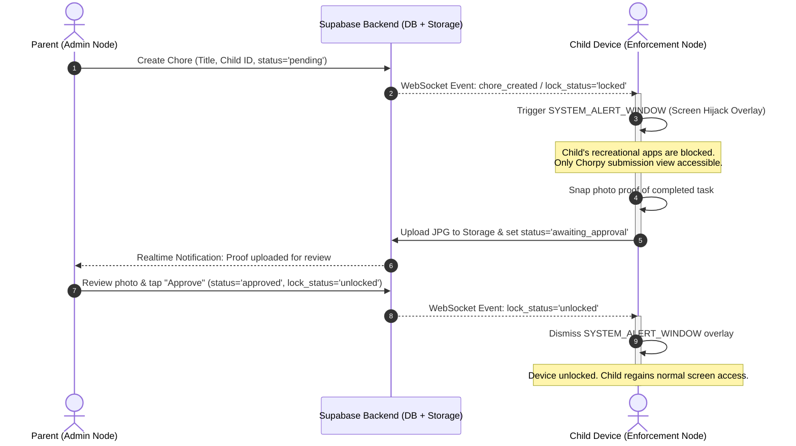
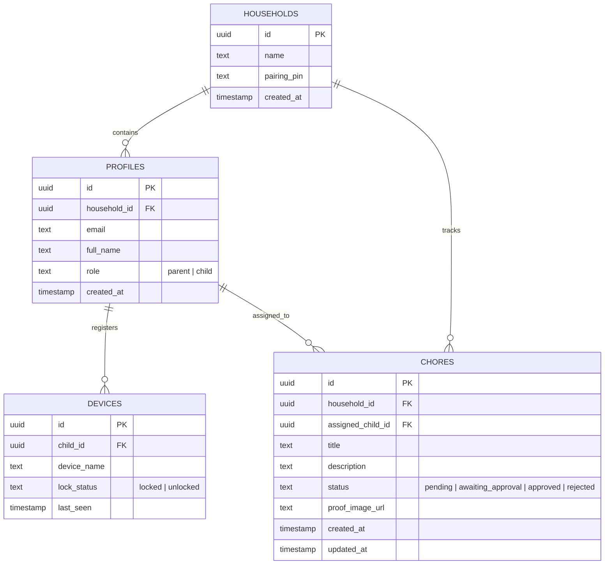

# CHORPY
### A Networked Household Chore Management & Digital Wellbeing System

[](https://reactnative.dev/)
[](https://expo.dev/)
[](https://supabase.com/)
[](https://developer.android.com/)
[](https://opensource.org/licenses/MIT)

---

## 1. Executive Summary

**Chorpy** is an IoT-inspired household chore management and digital wellbeing ecosystem built with **React Native / Expo** and **Supabase**. It bridges the gap between digital screen entertainment and physical domestic responsibilities by establishing a synchronized parent-child device relationship across the household.

Unlike traditional chore charts that are passive and easily ignored, or generic parental control apps that rely on arbitrary timers, Chorpy introduces a **merit-based digital enforcement model**:

1. **The Hook:** Children earn access to their personal devices by completing assigned household chores.
2. **The Lock:** If a mandatory chore is pending, the child's Android device is immediately locked via a hardware-level, non-dismissible screen overlay (`SYSTEM_ALERT_WINDOW`).
3. **The Proof:** To restore screen access, the child captures and submits photo evidence of the completed chore. Once the parent reviews and approves the submission, the lock is instantly dissolved via real-time WebSocket state synchronization.

---

## 2. Problem Statement & Motivation

| Traditional Paradigm | The Pain Point | The Chorpy Solution |
| :--- | :--- | :--- |
| **Manual Chore Charts** | Passive, static, and easily ignored; requires continuous verbal nagging from parents. | **Automated Enforcement:** Physical chores are directly tethered to digital privileges. |
| **Time-Quota Screen Limiters** | Imposes arbitrary daily time limits without instilling responsibility or accountability. | **Merit-Driven Access:** Screen time is earned by verifying domestic tasks, not granted passively. |
| **Local-Network Trackers** | Fails on mobile data (4G/5G) or across segmented guest Wi-Fi networks with client isolation. | **Cloud-Synchronized (PIN/QR):** Realtime WebSocket sync via Supabase works across any network or cellular connection. |

---

## 3. System Architecture & Data Flow

Chorpy operates on a hub-and-spoke real-time architecture connecting two distinct application roles through a managed cloud backend.

```
┌─────────────────────────────────────────────────────────────┐
│                 PARENT CONTROL NODE                         │
│            (Mobile Parent Dashboard Interface)              │
│  - Task Assignment & Scheduling                            │
│  - 6-Digit Household Pairing Code Generator                 │
│  - Photo Proof Review & Remote Unlock Commands              │
└──────────────────────────────┬──────────────────────────────┘
                               │ HTTP / WebSocket
                               ▼
┌─────────────────────────────────────────────────────────────┐
│             SUPABASE REALTIME & DATA BACKEND                │
│  - PostgreSQL Database (RLS Policies & Role Management)     │
│  - Realtime WebSocket Engine (Instant State Broadcasting)   │
│  - Supabase Storage (JPG Photo Proof Uploads)               │
└──────────────────────────────▲──────────────────────────────┘
                               │ WebSocket Subscription
                               ▼
┌─────────────────────────────────────────────────────────────┐
│                 CHILD ENFORCEMENT NODE                      │
│            (Android Native / Expo Dev Client)               │
│  - System Overlay Manager (SYSTEM_ALERT_WINDOW Lock)        │
│  - Camera Proof Capture Module                              │
│  - Real-time State Listener (devices table lock_status)     │
└─────────────────────────────────────────────────────────────┘
```

### Core Enforcement & Verification Sequence



---

## 4. Functional Requirements (FR) & Specifications

### 4.1. User Authentication & Role Management
*These requirements define how different users access and navigate the system.*
- **FR-1.1:** The system shall allow a user to register an account utilizing an email and password.
- **FR-1.2:** The system shall strictly route users to either a "Parent" dashboard or a "Child" enforcement view based on their assigned role upon login.
- **FR-1.3:** The system shall generate a unique 6-digit PIN to pair a new child device securely to the parent's household network.

### 4.2. Task Assignment & Data Processing
*These requirements detail the specific workflows for creating and managing chores.*
- **FR-2.1:** The system shall allow a parent user to create a new chore containing a title, assigned child, and status.
- **FR-2.2:** The system shall update the chore's status from `'pending'` to `'awaiting_approval'` when a child submits a photo proof.
- **FR-2.3:** The system shall capture and upload a `.jpg` image from the child's device camera to the cloud storage bucket (`chore-proofs`).

$$\text{pending} \xrightarrow{\text{photo upload}} \text{awaiting\_approval} \xrightarrow{\text{parent approval}} \text{approved / unlocked}$$

### 4.3. Device Enforcement & State-Driven Actions
*These requirements outline the core behavioral triggers of the application.*
- **FR-3.1:** The system shall activate a non-dismissible `SYSTEM_ALERT_WINDOW` overlay on the child's Android device if a chore status is `'pending'`.
- **FR-3.2:** The system shall instantly remove the locking overlay when the parent manually changes the device's `lock_status` to `'unlocked'`.
- **FR-3.3:** The system shall push real-time state changes to the child's device over a WebSocket connection without requiring a manual page refresh.

---

## 5. Non-Functional Requirements (NFR)

### 5.1. Performance & Efficiency
- **Time Behavior (Latency):** The Supabase WebSocket connection must deliver the unlock payload to the child's device instantly to trigger the state change.
- **Resource Utilization (Battery Overhead):** The background process listening for changes in the `devices` table must consume minimal battery overhead so the Android OS does not aggressively terminate the listener.
- **Capacity:** The cloud storage and database must handle concurrent photo-proof uploads efficiently, specifically optimized for the planned 5–10 household stress test in Cagayan de Oro.

### 5.2. Security & Data Integrity
- **Access Control (Authorization):** The PostgreSQL database must enforce strict policies ensuring that only an authenticated control node (the parent) can execute the `UPDATE` operations required to approve a chore and trigger an unlock.
- **Data Confidentiality (Encryption):** The system must utilize secure HTTPS and WSS protocols to encrypt the transmission of the direct QR/PIN pairing codes and all submitted photo evidence.
- **Integrity Validation (Tamper Resistance):** The `SYSTEM_ALERT_WINDOW` overlay must be non-dismissible, successfully bypassing standard Android navigation (like the home or back buttons) to safely mimic an OS-level lock.

### 5.3. Reliability & Fault Tolerance
- **Network Recovery (Auto-Reconnection):** If the child's device loses cellular or Wi-Fi connectivity, the application must automatically re-establish the Supabase real-time subscription the moment the network returns.
- **Data Persistence (State Retention):** The system must retain the `'locked'` state locally on the device so that if a child attempts to bypass the lock by forcibly rebooting the Android phone, the overlay immediately re-engages upon startup.
- **Fault Tolerance (Graceful Degradation):** The React Native architecture must implement strict error boundaries so that a failure in the Expo Camera module during photo capture does not crash the underlying background service enforcing the lock.

### 5.4. Maintainability & Portability
- **Modularity (Separation of Concerns):** The codebase must strictly separate the React Native UI components from the Supabase data-fetching logic to ensure the system is easy to modify when transitioning to a self-hosted server later in the semester.
- **Adaptability (Mobile-First Architecture):** The system operates strictly as a native mobile application (mobile-only, no web dependency), providing responsive layouts tailored specifically for mobile phone screens.
- **Installability (Frictionless Deployment):** The child enforcement application must be compiled as a standalone Android `.apk` that can be directly sideloaded, allowing you to manually grant the `SYSTEM_ALERT_WINDOW` permission for the live demo without navigating Google Play Store red tape.

---

## 6. Developer Dual-Workflow (Expo Go vs. Dev Build)

To balance rapid UI development with low-level Android native permissions, Chorpy utilizes a **two-tier development strategy**:

```
                  ┌──────────────────────────────────────────────┐
                  │              CHORPY REPOSITORY               │
                  └──────┬────────────────────────────────┬──────┘
                         │                                │
            ┌────────────▼───────────┐       ┌────────────▼───────────┐
            │        EXPO GO         │       │     EXPO DEV BUILD     │
            │  (Rapid UI Iteration)  │       │ (Native Enforcement)   │
            └────────────┬───────────┘       └────────────┬───────────┘
                         │                                │
        • Parent Dashboard design           • SYSTEM_ALERT_WINDOW testing
        • Chores list & state styling       • Hardware screen-hijacking
        • Camera preview & auth flows       • Android background service
        • Zero compilation wait time        • End-to-end defense rehearsal
```

> [!TIP]
> **Recommended Developer Practice:** Keep both **Expo Go** and the **Expo Dev Build (`.apk`)** installed on your testing device. Use Expo Go for day-to-day component styling and database workflows; switch to the Dev Build when verifying overlay hijacking and native lifecycle events.

---

## 7. Project Roadmap

### Phase 1: Academic Defense MVP (Current Scope)
- [x] Comprehensive architecture design & repository initialization.
- [ ] Supabase PostgreSQL schema, RLS policies, and storage bucket configuration.
- [ ] 6-Digit PIN pairing logic bridging parents and children across networks.
- [ ] React Native Parent Dashboard with real-time approvals.
- [ ] Android native module / config plugin for `SYSTEM_ALERT_WINDOW` overlay enforcement.
- [ ] End-to-end WebSocket loop validation (Create $\rightarrow$ Lock $\rightarrow$ Capture $\rightarrow$ Approve $\rightarrow$ Unlock).

### Phase 2: Closed Beta & Real-World Stress Testing (Post-Defense)
- Deployment across 5–10 sample households in Cagayan de Oro for empirical user feedback.
- Anti-evasion hardening (preventing force-quit, safe-mode bypass, or permission revocation).
- Local mDNS network discovery fallback for offline environments.

### Phase 3: Commercial Startup & Compliance
- **AI Auto-Verification (Gemini Vision API):** Supabase Edge Function processing image proofs against chore prompt heuristics, enabling automated instant unlocks.
- **Cross-Platform Compliance:** Official submissions for Android Accessibility Service / Device Admin APIs and Apple `FamilyControls` entitlement.
- **Token Economy:** Gamified chore incentives, point multipliers, and screen time banking.

---

## 8. Database Schema & Data Models

### Database Entity-Relationship Overview



### PostgreSQL Table Definition (Supabase SQL)

```sql
-- Enable UUID extension
create extension if not exists "uuid-ossp";

-- Households
create table public.households (
    id uuid primary key default uuid_generate_v4(),
    name text not null,
    pairing_pin varchar(6) not null unique,
    created_at timestamp with time zone default timezone('utc'::text, now()) not null
);

-- Profiles (Users mapped from auth.users)
create table public.profiles (
    id uuid primary key references auth.users on delete cascade,
    household_id uuid references public.households(id) on delete set null,
    email text not null,
    full_name text,
    role text check (role in ('parent', 'child')) not null default 'child',
    created_at timestamp with time zone default timezone('utc'::text, now()) not null
);

-- Registered Enforcement Devices
create table public.devices (
    id uuid primary key default uuid_generate_v4(),
    child_id uuid not null references public.profiles(id) on delete cascade,
    device_name text not null,
    lock_status text check (lock_status in ('locked', 'unlocked')) default 'unlocked' not null,
    last_seen timestamp with time zone default timezone('utc'::text, now()) not null
);

-- Household Chores
create table public.chores (
    id uuid primary key default uuid_generate_v4(),
    household_id uuid not null references public.households(id) on delete cascade,
    assigned_child_id uuid not null references public.profiles(id) on delete cascade,
    title text not null,
    description text,
    status text check (status in ('pending', 'awaiting_approval', 'approved', 'rejected')) default 'pending' not null,
    proof_image_url text,
    created_at timestamp with time zone default timezone('utc'::text, now()) not null,
    updated_at timestamp with time zone default timezone('utc'::text, now()) not null
);

-- Enable Realtime for chore states and device locks
alter publication supabase_realtime add table public.chores;
alter publication supabase_realtime add table public.devices;
```

---

## 9. Getting Started

### 9.1. Prerequisites
- [Node.js](https://nodejs.org/) (v18.x or v20.x LTS)
- [Expo CLI](https://docs.expo.dev/get-started/installation/) (`npm install -g expo-cli eas-cli`)
- [Android Studio](https://developer.android.com/studio) (configured with Android SDK platform-tools & emulator, or a physical Android device connected via USB/Wi-Fi)
- A free [Supabase](https://supabase.com/) project account

### 9.2. Environment Configuration
Create a `.env` file in the project root:

```env
EXPO_PUBLIC_SUPABASE_URL=https://your-supabase-project.supabase.co
EXPO_PUBLIC_SUPABASE_ANON_KEY=your-supabase-anon-key
```

### 9.3. Installation

```bash
# Clone the repository
git clone https://github.com/JohnLloydCanoy/chorpy.git
cd chorpy

# Install project dependencies
npm install
```

### 9.4. Running the Development Server

#### Running with Expo Go (UI & Logic Prototyping)
```bash
npx expo start
```
Scan the QR code with your Expo Go app on iOS or Android.

#### Running with Android Dev Client (Native Screen Overlay Testing)
```bash
# Prebuild native Android project files
npx expo run:android
```

> [!IMPORTANT]
> **Granting Overlay Permissions:**
> On the physical Android test device, navigate to:
> `Settings` $\rightarrow$ `Apps` $\rightarrow$ `Special app access` $\rightarrow$ `Display over other apps` $\rightarrow$ Select **Chorpy** $\rightarrow$ Toggle **Allow display over other apps** to ON.

---

## 10. Academic Defense Live Demo Walkthrough

When conducting a live demonstration before panel evaluators:

1. **Parent Device (Mobile App):** Open the Chorpy mobile app on the parent's phone logged in as `parent@chorpy.local`.
2. **Child Device (Mobile App):** Hold the physical Android device running the Chorpy Dev Build logged in as `child@chorpy.local`.
3. **Step 1 — Create Task:** From the parent mobile app, create a chore titled `"Clean Computer Desk"` and assign it to the child.
4. **Step 2 — Immediate Screen Hijack:** Show the audience that the child's phone screen instantly freezes and is overtaken by the full-screen non-dismissible Chorpy locking overlay. Attempting to press Home or Back returns to the lock screen.
5. **Step 3 — Photo Submission:** Tap *"Take Photo Proof"* within the overlay container on the child's phone, take a picture of the desk, and hit submit. The child's UI transitions to `"Waiting for Parent Approval"`.
6. **Step 4 — Realtime Parent Verification:** Show the parent's phone screen; without refreshing or pulling down, the parent dashboard updates in real-time to display the uploaded photo proof.
7. **Step 5 — Instant Unlock:** Tap *"Approve Task"* on the parent app. Point back to the child device in your hand; the locking overlay immediately disappears, returning the phone to normal home screen access in sub-second time.

---

## 11. Technology Stack

- **Framework:** [React Native](https://reactnative.dev/) with [Expo](https://expo.dev/) (Managed Workflow + Prebuild Dev Clients)
- **Language:** [TypeScript](https://www.typescriptlang.org/)
- **Backend / BaaS:** [Supabase](https://supabase.com/)
  - Database: PostgreSQL
  - Realtime: WebSockets (`supabase-js`)
  - Storage: Supabase Storage S3-compatible Buckets
  - Authentication: Supabase Auth (JWT)
- **Native Android API:** Android `SYSTEM_ALERT_WINDOW` API
- **Styling & UI:** TailwindCSS / [NativeWind](https://www.nativewind.dev/) or StyleSheet architecture

---

## 12. Authors & Academic Acknowledgments

Developed as an Academic Capstone Project for Mobile Programming.

- **Author / Lead Developer:** John Lloyd Canoy ([@JohnLloydCanoy](https://github.com/JohnLloydCanoy))
- **Institution:** Department of Computer Science / Information Technology, Cagayan de Oro, Philippines
- **Course:** Mobile Programming (`mob-prog`)

---

## 13. License

This project is licensed under the [MIT License](LICENSE) — see the LICENSE file for details.
