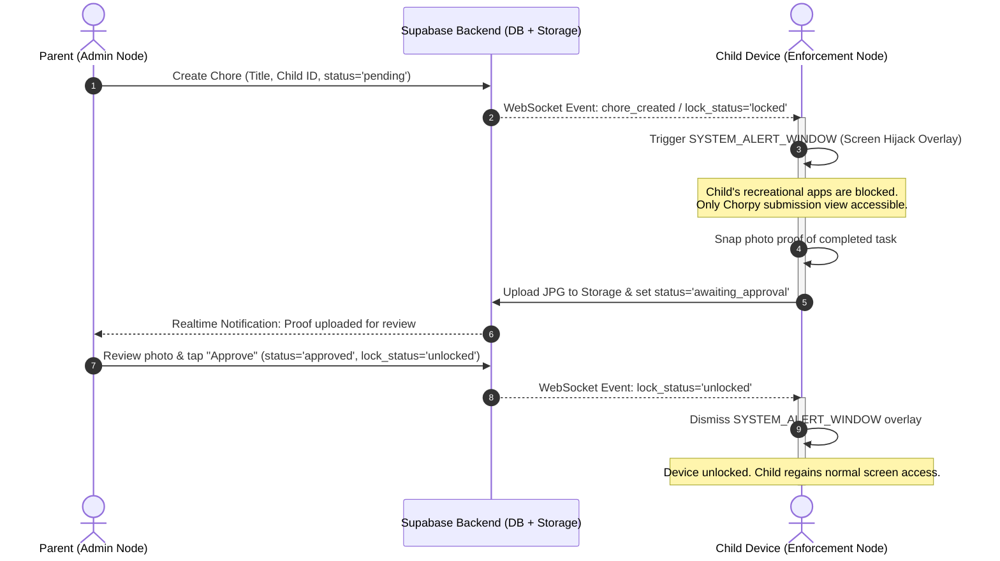
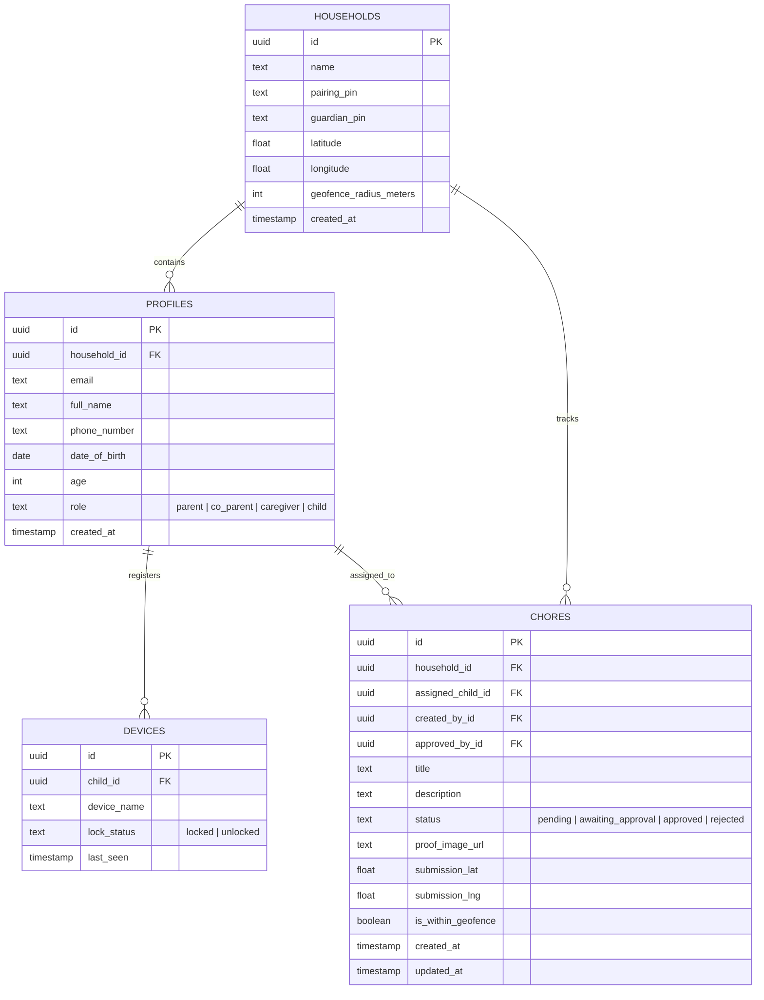

<div align="center">

# CHORPY
### A Networked Household Chore Management & Digital Wellbeing System

[](https://reactnative.dev/)
[](https://expo.dev/)
[](https://supabase.com/)
[](https://developer.android.com/)
[](https://opensource.org/licenses/MIT)

</div>

---

## 1. Executive Summary

**Chorpy** is an IoT-inspired household chore management and digital wellbeing ecosystem built with **React Native / Expo** and **Supabase**. It bridges the gap between digital screen entertainment and physical domestic responsibilities by establishing a synchronized parent-child device relationship across the household.

Unlike traditional chore charts that are passive and easily ignored, or generic parental control apps that rely on arbitrary timers, Chorpy introduces a **merit-based digital enforcement model**:

1. **The Hook:** Children earn access to their personal devices by completing assigned household chores.
2. **The Lock:** If a mandatory chore is pending, the child's Android device is immediately locked via a hardware-level, non-dismissible screen overlay (`SYSTEM_ALERT_WINDOW`).
3. **The Proof:** To restore screen access, the child captures and submits photo evidence of the completed chore. Once the parent reviews and approves the submission, the lock is instantly dissolved via real-time WebSocket state synchronization.

### 1.1. End-to-End Application Flow

Chorpy structures the household experience into two distinct phases: **Onboarding & Family Circle Setup** followed by the **Daily Chore Enforcement Loop**:

#### Phase 1: Onboarding & Family Circle Setup
1. **Download the App:** Install the Chorpy mobile app on both the Parent and Child devices.
2. **Create Your Account:** Register and authenticate using email and password via Supabase Auth, capturing profile details (Full Name, Phone Number, Date of Birth, and dynamically derived Age).
3. **Select Your Role:** Designate the profile role:
   - **Adult (Admin / Guardian Node):** Choose between establishing a new household (**Primary Parent**) or joining an existing Circle as a secondary guardian (**Co-Parent, Grandparent, or Caregiver/Nanny**).
   - **Child (Enforcement Node):** Restricted node that pairs to the household for chore tracking and device screen enforcement.
4. **Automated Circle Provisioning & Dual-PIN Pairing:**
   - **Primary Parent (Creator):** Automatically provisions a new household Circle upon account registration, generating two distinct codes: a **Child Pairing PIN** and a **Guardian Invite PIN/QR**.
   - **Co-Parents / Caregivers (Dad, Grandma, Nanny):** Enter the **Guardian Invite PIN** to join the existing household without creating duplicate circles, instantly sharing chore management and approval capabilities.
   - **Child:** Enters the **Child Pairing PIN** to pair their physical device with the household Circle.
5. **Enable Device Permissions:**
   - **Camera & Storage Access:** Required for taking and uploading photo evidence of chores.
   - **Location Access:** Enables family circle proximity and location-aware household features.
   - **Display Over Other Apps (`SYSTEM_ALERT_WINDOW`):** *(Child device only)* Required to enforce non-dismissible screen overlays when chores are pending.

#### Phase 2: Daily Chore Lifecycle, Enforcement & Safety Loop
6. **Manage & Assign Chores (The Lock & Concurrency Guard):**
   - An authorized adult (Parent, Co-Parent, or Caregiver) creates a chore. If multiple chores are assigned, they are bundled into a sequential queue (`1 of 2 chores`).
   - If an adult attempts to assign a duplicate task, the concurrency guard prompts them to merge or view the existing chore.
   - In real-time via WebSockets, the child’s Android device freezes behind a full-screen, non-dismissible overlay (`SYSTEM_ALERT_WINDOW`), blocking access to apps and the home screen.
7. **Photo Proof Submitted (The Proof & Geofence Check):**
   - Within the locked overlay, the child accesses the camera, snaps a photo of the completed chore, and submits it.
   - The submission automatically verifies and tags physical presence against the household geofence (`Within Household Perimeter`).
   - The chore status automatically updates to `awaiting_approval`.
8. **Collaborative Verification & Unlock (The Release):**
   - Any authorized adult (Mom, Dad, or Nanny) reviews the photo proof in real time from their dashboard.
   - Tapping **"Approve"** broadcasts an unlock event attributing the reviewer (*"Approved by Dad"*), dissolving the screen overlay on the child's phone in sub-second time.
9. **Emergency SOS Life-Safety Override (The Safety Anchor):**
   - At any moment during active lock enforcement, the child can tap the persistent **"🚨 Emergency SOS"** action to place instant phone calls to parent contacts or `911` and broadcast real-time panic GPS telemetry to all guardian dashboards.

---

## 2. Problem Statement & Motivation

| Traditional Paradigm | The Pain Point | The Chorpy Solution |
| :--- | :--- | :--- |
| **Manual Chore Charts** | Passive, static, and easily ignored; requires continuous verbal nagging from parents. | **Automated Enforcement:** Physical chores are directly tethered to digital privileges. |
| **Time-Quota Screen Limiters** | Imposes arbitrary daily time limits without instilling responsibility or accountability. | **Merit-Driven Access:** Screen time is earned by verifying domestic tasks, not granted passively. |
| **Local-Network Trackers** | Fails on mobile data (4G/5G) or across segmented guest Wi-Fi networks with client isolation. | **Cloud-Synchronized (PIN/QR):** Realtime WebSocket sync via Supabase works across any network or cellular connection. |

---

## 3. Brand Identity & Mascot System

### 3.1. Mascot Persona: "Chorpy the Maya"
The app's mascot is modeled after the **Eurasian Tree Sparrow** (locally recognized across the Philippines as the ***Maya***). Renowned for its energetic morning presence and industrious habit of constantly collecting materials to build and tidy its nest, the Maya perfectly embodies domestic responsibility and active household habits.

To move beyond traditional muted earthy tones into a vibrant, modern tech product aesthetic, Chorpy is stylized in a **Sky Blue & Bright Coral Orange** visual system:

- **Silhouette:** A compact, round, approachable songbird with large expressive eyes designed for high readability at mobile app-icon scale.
- **Cheek Spot:** The iconic cheek patch of the Eurasian Tree Sparrow, reimagined in sharp Slate Navy.
- **Chest & Beak:** A vibrant Coral Orange chest patch and beak that pulse and glow during reward moments and celebratory unlocks.

### 3.2. Color Palette & Design Tokens

| Role | Token Name | Hex Code | Visual Feeling & UI Application |
| :--- | :--- | :--- | :--- |
| **Primary Base** | **Sky Blue** | `#38BDF8` | App headers, primary action buttons, feather body (clean, digital, calm) |
| **Warm Accent** | **Bright Coral Orange** | `#FF6B4A` | Unlock CTAs, notification badges, chest patch (energetic, motivating warmth) |
| **Contrast / Neutral** | **Slate Navy** | `#0F172A` | Signature cheek spots, headings, high-contrast typography |
| **Surface** | **Cloud White** | `#F8FAFC` | Clean card containers, modals, and background surfaces |

### 3.3. In-App Contextual Mascot States

| App State | Screen / Context | Chorpy's Posture & Visual Cue |
| :--- | :--- | :--- |
| **🔒 Pending / Locked** | Full-Screen Overlay | Chorpy stands guard over a padlock: *"Chores first, screen time later!"* |
| **📸 Photo Submission** | Camera Viewfinder | Chorpy peers through a magnifying glass: *"Snap a clear picture of your work!"* |
| **⏳ Awaiting Review** | Awaiting Approval | Chorpy sips tea beside a timer: *"Sent to parent! Awaiting review..."* |
| **🎉 Approved / Unlocked** | Realtime Unlock Dissolve | Chorpy takes flight with keys in beak amidst confetti: *"All clean! Enjoy screen time!"* |
| **🚨 Emergency SOS** | Lock Screen Emergency Action | Chorpy equipped with a rescue megaphone: *"Help is on the way! Calling family & broadcasting GPS..."* |
| **👨‍👩‍👧 Family Circle** | Circle Members List | Chorpy perched in a stylized nest displaying the household pairing PIN. |

---

## 4. System Architecture & Data Flow

Chorpy operates on a hub-and-spoke real-time architecture connecting two distinct application roles through a managed cloud backend.

```
┌─────────────────────────────────────────────────────────────┐
│             PARENT & GUARDIAN CONTROL NODES                 │
│     (Mom, Dad, Grandparent, Nanny - RBAC Delegated)         │
│  - Task Assignment & Multi-Guardian Scheduling              │
│  - Dual-PIN Household Pairing Generator (Child & Guardian)  │
│  - Collaborative Proof Review & Remote Unlock Commands      │
└──────────────────────────────┬──────────────────────────────┘
                               │ HTTP / WebSocket
                               ▼
┌─────────────────────────────────────────────────────────────┐
│             SUPABASE REALTIME & DATA BACKEND                │
│  - PostgreSQL Database (RLS Policies & Role Management)     │
│  - Realtime WebSocket Engine (Instant State Broadcasting)   │
│  - Supabase Storage (JPG Photo Proof Uploads)               │
└──────────────────────────────▲──────────────────────────────┘
                               │ WebSocket Subscription
                               ▼
┌─────────────────────────────────────────────────────────────┐
│                 CHILD ENFORCEMENT NODE                      │
│            (Android Native / Expo Dev Client)               │
│  - System Overlay Manager (SYSTEM_ALERT_WINDOW Lock)        │
│  - Camera Proof Capture Module                              │
│  - Real-time State Listener (devices table lock_status)     │
└─────────────────────────────────────────────────────────────┘
```

### Core Enforcement & Verification Sequence



---

## 5. Functional Requirements (FR) & Specifications

### 5.1. Account Onboarding & Role Selection
*These requirements define how users establish accounts, ingest verified profile data, and identify their permissions.*
- **FR-1.1 (Account Registration & Profile Ingestion):** The system shall allow a user to register and authenticate an account utilizing an email and password via Supabase Auth, capturing personal profile details (full name, phone number, and date of birth) with intelligent field handling:
  - **FR-1.1.1 (Dynamic Age Derivation):** The user’s age shall be computed automatically in real time from the inputted `date_of_birth`, eliminating redundant manual inputs and temporal data drift.
  - **FR-1.1.2 (Age-Aware Role Recommendation):** The system shall evaluate the calculated age to intelligently suggest or enforce the appropriate role profile (e.g., `< 18` automatically pre-selects/defaults to **Child Node**; `≥ 18` pre-selects **Parent Admin Node**).
  - **FR-1.1.3 (Smart Input Masking & Sanitization):** The phone number field shall feature automatic input masking (standardizing to E.164 international format) and auto-trimming/title-casing for full names.
- **FR-1.2 (Intelligent Role Designation & Anti-Escalation Safeguard):** The system shall require the user to configure their profile role as either a **Parent (Admin Node)** or a **Child (Enforcement Node)**, secured by contextual validation:
  - **FR-1.2.1 (Age-Gated Role Authorization):** If the derived age is under 18, the system shall restrict the selection to a **Child Node** by default; claiming a **Parent Node** shall require administrative verification to prevent unauthorized privilege escalation by minors.
  - **FR-1.2.2 (Role Immutability & Hardware Binding):** Once a profile and its physical device are successfully bound to a household Circle, the assigned role shall be immutable on the local device and can only be modified or revoked by an authenticated Parent Node.
- **FR-1.3 (Adaptive State-Driven Navigation & Fail-Closed Routing):** The system shall deterministically route authenticated users through a state-machine-driven navigation hierarchy based on role, household association, and real-time chore enforcement states:
  - **FR-1.3.1 (Multi-Stage Lifecycle Routing):** The router shall evaluate pre-requisite milestones before rendering primary views:
    1. *Unpaired Adult Profile* $\rightarrow$ Route to **Household Intent Fork Screen** (*"Create New Family Circle"* vs. *"Join Existing Family Circle"*).
    2. *Unpaired Child Profile* $\rightarrow$ Route directly to **Child PIN Entry / QR Scanner Screen** (to connect to the parent's circle).
    3. *Incomplete System Permissions* $\rightarrow$ Route to **Hardware Handshake Wizard** (Overlay, Camera, and Location).
    4. *Verified Adult Node (Owner / Co-Parent / Caregiver)* $\rightarrow$ Route directly to **Parent Command Dashboard** (featuring the auto-generated pairing PINs, real-time device telemetry, chore creation, and proof reviews).
    5. *Child Node (Active / Pending Chores)* $\rightarrow$ Instantly engage the **Non-Dismissible Screen Lock (`SYSTEM_ALERT_WINDOW`)**.
    6. *Child Node (Chores Cleared / Approved)* $\rightarrow$ Route to **Digital Wellbeing Companion View** (displaying earned screen time and chore stats).
  - **FR-1.3.2 (Fail-Closed Offline Enforcement & Anti-Evasion Guard):** The system shall maintain continuous enforcement state resilience across network disconnections, system reboots, and offline environments through local state persistence and fail-closed security logic:
    - **FR-1.3.2.1 (Encrypted On-Device State Persistence):** The mobile client shall persistently cache the active device enforcement state (`'locked'` vs. `'unlocked'`), pending chore identifiers, and last-verified timestamps in secure local storage (`AsyncStorage` / Android Keystore) upon every state transition.
    - **FR-1.3.2.2 (Offline Fail-Closed Default Policy):** If the application launches or detects a total loss of network connectivity (e.g., Airplane Mode or Wi-Fi disconnection), the router shall query the local storage cache; if the last recorded state was `'locked'`, the system shall deterministically engage the `SYSTEM_ALERT_WINDOW` overlay and reject unverified client unlocks.
    - **FR-1.3.2.3 (Android Boot-Time State Restoration):** The native Android module shall register a `BOOT_COMPLETED` broadcast receiver to inspect local persistence immediately upon device power-on, relaunching the locking overlay before background or recreational applications can be accessed.
    - **FR-1.3.2.4 (Network Recovery Auto-Resynchronization):** Upon detection of network restoration (via Android NetInfo / WebSocket reconnection), the client node shall execute an immediate state handshake with the Supabase `devices` table to synchronize pending approvals and dissolve the overlay if an approval occurred while offline.
  - **FR-1.3.3 (Server-Side Authorization Parity & Zero-Trust RLS):** The backend database shall enforce a strict Zero-Trust security model using PostgreSQL Row Level Security (RLS) policies that independently validate every transaction, guaranteeing that client-side UI tampering cannot compromise administrative privileges:
    - **FR-1.3.3.1 (Cryptographic JWT Role Extraction):** Every database query and WebSocket subscription shall cryptographically extract and verify the caller’s user ID (`auth.uid()`) and assigned role from the server-signed Supabase JWT, completely ignoring unverified client-side metadata or parameters.
    - **FR-1.3.3.2 (Mutation Gatekeeping & Privilege Isolation):** PostgreSQL RLS policies shall enforce strict, role-specific mutation gates across database tables (restricting chore approvals and `'unlocked'` device signals exclusively to verified adult roles, while restricting children to proof uploads).
    - **FR-1.3.3.3 (Household Multi-Tenant Boundary Isolation):** All database operations across `chores`, `devices`, and `households` shall enforce a mandatory `household_id` match against the caller's profile, preventing any user from reading or mutating data across different family circles.
    - **FR-1.3.3.4 (Fail-Closed Tamper Rejection):** If a child token attempts to execute an unauthorized administrative mutation, the database engine shall reject the operation immediately via a fail-closed `HTTP 403 Forbidden / RLS Policy Violation`, preventing unauthorized state changes.
- **FR-1.4 (Credential Validation & Policy Enforcement):** The system shall enforce strict client-side and server-side validation rules on authentication credentials prior to account creation and authentication:
  - **FR-1.4.1 (Email Format Standardization):** The system shall validate email address inputs against standard RFC 5322 syntax (requiring a valid recipient name, an `@` symbol, and a top-level domain e.g., `user@domain.com`), rejecting malformed submissions with immediate inline error feedback.
  - **FR-1.4.2 (Password Complexity & Entropy Rules):** The system shall require passwords to be at least eight (8) characters in length and enforce a composition policy containing at least one uppercase letter (`A-Z`), one lowercase letter (`a-z`), and one numeric digit (`0-9`), accompanied by visual real-time requirement feedback as the user types.
- **FR-1.5 (Household Intent Gateway: Creation vs. Federation):** Prior to accessing primary system features, the system shall intercept authenticated adult users at a dedicated onboarding gateway (`HouseholdForkScreen.tsx`) to declare their circle association intent:
  - **FR-1.5.1 (Circle Creation Pathway - Primary Parent):** Selecting *"Create a New Circle"* designates the user as the Primary Parent / Circle Owner, triggers zero-click automated circle provisioning, generates the dual-PIN pairing keys (Child & Guardian), and routes directly to the dashboard.
  - **FR-1.5.2 (Circle Federation Pathway - Secondary Adult):** Selecting *"Join an Existing Circle"* routes the adult to the `JoinCircleScreen.tsx` to enter the Guardian Invite PIN or scan the Primary Parent's QR code, binding them to the existing household as Co-Parent or Caregiver without fragmenting into duplicate circles.
  - **FR-1.5.3 (Child Node Pathway Restriction):** Accounts verified as children (`role = 'child'`) shall be strictly restricted from circle creation pathways and routed directly to the Child PIN / QR pairing gateway.

### 5.2. Family Circle Management, Multi-Guardian Pairing & RBAC
*These requirements govern the automated establishment, multi-guardian federation, and role-based permissions across household accounts.*
- **FR-2.1 (Zero-Click Automated Household Circle Provisioning):** The system shall automatically provision a new household Circle for an initial parent account immediately upon successful registration and role designation:
  - **FR-2.1.1 (Dual-PIN Architecture Generation):** The system shall generate two distinct, cryptographically collision-free codes for each household: a **Child Pairing PIN** (for device enforcement binding) and a **Guardian Invite PIN / QR code** (for secondary adult onboarding).
  - **FR-2.1.2 (Instant Admin Binding & Zero-Friction Routing):** The system shall immediately link the registering parent as the Circle Owner/Admin and bypass manual household forms, directly routing them to the Parent Dashboard with pairing codes ready for distribution.
- **FR-2.2 (Child Circle Pairing & Device Hardware Handshake):** The system shall guide the child user through a friction-free, secure household onboarding and device registration process:
  - **FR-2.2.1 (Child-Friendly PIN Entry UX & QR Scanner):** The interface shall present an intuitive 6-digit input mechanism featuring automatic digit focus advancement, numeric keypad enforcement, auto-submission upon 6th digit entry, and an optional 1-tap QR code camera scanner to eliminate typing friction for younger children.
  - **FR-2.2.2 (Rate-Limited Validation & Anti-Guessing Guard):** The system shall validate entered PINs against active household records, enforcing a rate-limiting cooldown (maximum 5 failed attempts triggering a 60-second cooldown) accompanied by visual and haptic error feedback to prevent brute-force guessing.
  - **FR-2.2.3 (Hardware Fingerprint & Telemetry Ingestion):** Upon successful PIN validation, the client shall automatically extract and register physical device telemetry (manufacturer, hardware model e.g., *"Samsung A12"*, Android OS version, and unique client installation identifier) into the `public.devices` table, permanently binding the physical device to the child profile.
  - **FR-2.2.4 (Automated Transition to Permissions Wizard):** Immediately upon successful pairing confirmation, the system shall render a celebratory welcome cue from the Chorpy mascot and automatically route the child into the mandatory **Hardware Permissions Handshake** (Overlay, Camera, and Location).
- **FR-2.3 (Multi-Guardian Household Federation & QR Onboarding):** The system shall enable secondary adult users (Co-Parent, Grandparent, Caregiver/Nanny) to federate into an existing household Circle without creating fragmented duplicate accounts, guided by explicit UI screens:
  - **FR-2.3.1 (Primary Parent QR & PIN Presentation Hub):** The Primary Parent dashboard (`ParentDashboard.tsx` $\rightarrow$ `CircleSettingsModal`) shall provide an accessible management card that dynamically generates a high-contrast QR code (encoding household ID and guardian PIN) alongside a copyable 6-digit Guardian Invite PIN with native mobile share-sheet integration (SMS, WhatsApp, or clipboard).
  - **FR-2.3.2 (Secondary Adult Dual-Mode Pairing Screen):** During onboarding (`JoinCircleScreen.tsx`), the secondary adult shall be provided dual-mode verification: an embedded camera viewfinder to scan the parent's QR code in one tap, or a manual 6-digit PIN input fallback.
  - **FR-2.3.3 (Caregiver Relationship & Role Selection):** Upon successful PIN or QR resolution, the secondary adult shall designate their specific domestic relation via an in-app selector (*"Co-Parent"*, *"Grandparent"*, or *"Caregiver/Nanny"*), automatically provisioning the corresponding RBAC tier in `public.profiles`.
  - **FR-2.3.4 (Bidirectional WebSocket Roster Sync):** Successful guardian pairing shall trigger an immediate Supabase Realtime broadcast to all active circle administrators, updating the household member roster with an affirmative banner (*"John Doe joined as Co-Parent"*) and granting instant shared access to chore management and device telemetries.
- **FR-2.4 (Role-Based Access Control - RBAC for Guardians):** The system shall enforce tiered permissions among adult household members as defined in Section 6, preventing unauthorized privilege escalation and protecting administrative settings:
  - **FR-2.4.1 (Database-Level Role Enforcement):** User session tokens shall be checked against PostgreSQL Row Level Security (RLS) policies mapping to `public.profiles.role` (`'parent'`, `'co_parent'`, `'caregiver'`), rejecting unauthorized API mutations at the database level.
  - **FR-2.4.2 (Owner-Exclusive Administrative Safeguards):** Destructive actions—such as deleting the household circle, regenerating the master Guardian PIN, or removing adult members—shall be restricted exclusively to the Primary Parent (Owner).
  - **FR-2.4.3 (Delegated Caregiver Task Boundary):** Secondary caregivers and nannies shall have operational permissions to assign everyday chores, review submissions, and release locks, but shall be strictly restricted from viewing family billing or modifying household geofence boundaries.
  - **FR-2.4.4 (Dynamic UI Permission Adaptation):** The mobile client interface (`ParentDashboard.tsx`) shall dynamically evaluate the user's role and conditionally render administrative controls, hiding restricted action buttons from caregiver and co-parent views.
- **FR-2.5 (Real-Time Collaborative Approval Synchronization):** The system shall synchronize chore review actions across all connected adult devices via WebSockets, eliminating duplicate reviews and state conflicts:
  - **FR-2.5.1 (Instant Multi-Guardian Broadcast):** When an adult approves or rejects a chore, Supabase Realtime shall broadcast an event payload containing `chore_id`, updated `status`, `reviewer_id`, `reviewer_name`, and timestamp across the household channel.
  - **FR-2.5.2 (Audit Attribution & Toast Notification):** All active guardian dashboards shall immediately display a non-intrusive toast alert attributing the action (e.g., *"Dishes approved by Dad (John)"*), updating the chore card state without requiring a manual pull-to-refresh.
  - **FR-2.5.3 (Optimistic Concurrency & Collision Lockout):** If multiple guardians inspect the same submission simultaneously, the first approval transaction shall lock the chore and disable review actions on other screens with an inline badge (*"Already Approved by Dad"*), preventing conflicting decisions.
  - **FR-2.5.4 (Downstream Device Unlock Trigger):** Upon verification approval, the system shall immediately update the target child’s record in `public.devices` to `'unlocked'`, transmitting the release signal to the child device within 500 ms.
- **FR-2.6 (Live Circle Telemetry Roster & Remote Controls):** The system shall maintain an interactive, real-time family telemetry overview accessible on the parent dashboard:
  - **FR-2.6.1 (Child Node Health & Heartbeat Cards):** The dashboard shall render a dedicated card for each connected child device displaying the assigned child's name, hardware model, current lock state (`Locked` vs. `Unlocked`), battery level percentage, and last-seen heartbeat timestamp (`last_seen`).
  - **FR-2.6.2 (Active Guardian Roster Display):** The dashboard shall provide a members sheet displaying all connected adults, their designated relationship badges (Owner, Co-Parent, Caregiver), and their current real-time online status.
  - **FR-2.6.3 (Automated WebSocket State Telemetry):** The roster view shall subscribe to real-time changes on `public.devices` and `public.profiles`, automatically reflecting changes in battery status, device lock transitions, and member additions without page reloads.
  - **FR-2.6.4 (1-Tap Emergency Remote Override):** Primary Parents and Co-Parents shall have access to emergency override controls directly on each child card (e.g., *"Force Unlock for 30 Mins"* or *"Instant Emergency Lock"*).

### 5.3. Device Permissions & System Handshake
*These requirements ensure mandatory hardware and OS-level capabilities are verified before enforcement.*
- **FR-3.1:** The system shall request runtime permissions for **Camera & Photo Storage** on the child device to enable chore proof capture.
- **FR-3.2:** The system shall request runtime **Location Services** permissions to support family circle proximity and household awareness.
- **FR-3.3:** The system shall inspect and verify whether the child device has granted the **Android `SYSTEM_ALERT_WINDOW` ("Display over other apps")** permission.
- **FR-3.4:** The system shall provide an in-app button that directly deep-links the child user to the Android Special App Access settings page if overlay permissions are absent.
- **FR-3.5:** The system shall prevent a child device from entering standard operation until all mandatory enforcement permissions have been verified.

### 5.4. Chore Creation & Task Management
*These requirements detail the specific workflows for creating, scheduling, and tracking chores.*
- **FR-4.1:** The system shall allow a parent user to create a chore containing a title, description, assigned child, and status.
- **FR-4.2:** The system shall automatically set a newly assigned chore's status to `'pending'` upon creation.
- **FR-4.3:** The system shall provide an embedded camera viewfinder within the child's enforcement view to capture photo proof of the completed task.
- **FR-4.4:** The system shall compress and upload the captured image (`.jpg`) to the Supabase cloud storage bucket (`chore-proofs`).
- **FR-4.5:** The system shall automatically update the chore status from `'pending'` to `'awaiting_approval'` immediately following successful photo upload.
- **FR-4.6 (Collaborative Chore Deduplication & Concurrency Guard):** The system shall evaluate real-time chore assignments across co-parents and caregivers to detect, prevent, and resolve duplicate or conflicting tasks:
  - **FR-4.6.1 (Active Task Collision Detection & Fuzzy Matching):** When an adult drafts a chore for a specific child, the system shall execute fuzzy text matching against all currently active tasks (`'pending'` or `'awaiting_approval'`) assigned to that same child to identify identical or highly similar task scopes (e.g., *"Wash the dishes"* vs. *"Do dishes"*).
  - **FR-4.6.2 (Guardian Conflict Warning & Action Intercept):** If a potential collision is detected, the system shall intercept submission and display a real-time conflict modal identifying the assigning guardian and creation timestamp (e.g., *"Assigned by Mom 10m ago"*), offering three resolution actions:
    1. *View Existing Chore* (aborts duplicate submission and displays current active chore).
    2. *Merge Requirements* (links assignments under a unified proof requirement).
    3. *Create as Separate Task* (proceeds with submission upon explicit guardian confirmation).
  - **FR-4.6.3 (Single-Proof Collaborative Merging):** When duplicate chores are merged, the child shall be required to submit only a single photo proof to satisfy both assignments, allowing any authorized guardian to approve the consolidated task.
  - **FR-4.6.4 (Multi-Task Queueing & Aggregate Progress Tracking):** If multiple distinct chores are legitimately assigned concurrently (e.g., *"Clean Bedroom"* and *"Take Out Trash"*), the enforcement overlay shall bundle them into a synchronized task queue displaying real-time progress (e.g., *"1 of 2 Chores Completed"*), holding device screen lock until all assigned queue items are approved.

$$\text{pending} \xrightarrow{\text{photo upload}} \text{awaiting\_approval} \xrightarrow{\text{parent approval}} \text{approved / unlocked}$$

### 5.5. Hardware Device Enforcement & Verification Release
*These requirements define the real-time locking and unlocking mechanics.*
- **FR-5.1:** The system shall automatically trigger a full-screen, non-dismissible `SYSTEM_ALERT_WINDOW` overlay on the child's device whenever a chore is `'pending'`.
- **FR-5.2:** The overlay shall trap and suppress Android navigation inputs (such as Back and Home buttons) to prevent the child from accessing other mobile apps while locked.
- **FR-5.3:** The system shall display the submitted chore photo on the parent dashboard in real time without requiring a manual refresh.
- **FR-5.4:** The system shall allow the parent to tap **"Approve"** (updating chore status to `'approved'` and device state to `'unlocked'`) or **"Reject"** (reverting chore status to `'pending'`).
- **FR-5.5:** The system shall immediately dismiss the child's screen overlay and restore device access upon receiving the WebSocket `'unlocked'` broadcast.

### 5.6. Household Geolocation, Geofencing & Life-Safety SOS
*These requirements govern real-time family location awareness, geofenced chore verification, and emergency safety overrides.*
- **FR-6.1 (Emergency SOS & Life-Safety Call Bypass):** The system shall maintain an accessible, non-dismissible Emergency SOS action on the child device overlay during active lock states, enabling the child to immediately place outgoing phone calls to pre-configured parent contacts or national emergency services (`911`) without encountering screen lock restrictions.
- **FR-6.2 (Real-Time Panic Telemetry & GPS Broadcast):** Upon activation of the Emergency SOS trigger, the child node shall immediately transmit high-accuracy geolocation coordinates, a timestamp, and an urgent alert payload to the parent dashboard via high-priority Supabase Realtime broadcast.
- **FR-6.3 (Household Presence & Geofenced Chore Verification):** The system shall evaluate the child device’s geolocation against the household circle's registered coordinates at the moment of chore submission, tagging the proof review card with a verified home presence indicator (`Within Household Perimeter` vs. `Remote Submission`) to prevent deceptive remote submissions.
- **FR-6.4 (Passive Family Circle Telemetry):** The system shall provide a family location map on the parent dashboard displaying passive, battery-conscious location updates and battery level indicators for paired child devices.

---

## 6. Role-Based Access Control (RBAC) & Authority Matrix

To accommodate complex domestic caregiving arrangements (including co-parenting, multi-generational households, and domestic caregivers/nannies) without compromising system integrity, Chorpy implements a **Four-Tier Role-Based Access Control (RBAC)** architecture.

### 6.1. Household Authority Tiers

1. **👑 Primary Parent (Circle Owner):**
   - The creator and root administrator of the Household Circle.
   - Holds exclusive privileges to delete the Circle, regenerate Guardian Invite PINs, and revoke membership access for secondary guardians.
2. **🛡️ Co-Parent (Admin Node):**
   - Full operational co-administrator (e.g., Mom or Dad).
   - Holds full operational authority to create chores, approve/reject photo submissions, release device locks, and monitor live location telemetry.
3. **🤝 Caregiver / Nanny / Grandparent (Supervisor Node):**
   - Delegated domestic supervisor.
   - Granted everyday task management rights (assigning routine chores, inspecting photo proofs, and approving device unlocks), but restricted from altering circle configurations or removing members.
4. **🔒 Child (Enforcement Node):**
   - Strictly restricted subject node.
   - Constrained to viewing assigned tasks, uploading verification camera proof, and accessing the Emergency SOS life-safety trigger. All administrative controls and external application access (during active chores) are locked out.

### 6.2. Role-Based Permission Matrix

| Household Permission / Action | Primary Parent (Owner) | Co-Parent (Admin) | Caregiver / Nanny / Grandparent | Child (Enforcement Node) |
| :--- | :---: | :---: | :---: | :---: |
| **Assign & Schedule Chores** | ✅ Full | ✅ Full | ✅ Full | ❌ None |
| **Review Proof & Unlock Screen** | ✅ Full | ✅ Full | ✅ Full | ❌ None |
| **Trigger Emergency SOS Response** | ✅ Receives Alert | ✅ Receives Alert | ✅ Receives Alert | 🚨 Can Trigger |
| **View Family Live Location Map** | ✅ Full | ✅ Full | ✅ Delegated Access | ❌ Restricted |
| **Invite Members (View PINs / QR)** | ✅ Full | ✅ Full | ❌ Restricted | ❌ None |
| **Delete Circle / Remove Members** | 👑 Owner Only | ❌ Restricted | ❌ Restricted | ❌ None |

---

## 7. Non-Functional Requirements (NFR)

### 7.1. Performance & Responsiveness
- **Time Behavior (WebSocket Latency):** The Supabase WebSocket subscription must broadcast state transitions (e.g., Parent approval to Child unlock) in sub-second time (< 500 ms under standard 4G/Wi-Fi).
- **Image Optimization & Upload Speed:** The mobile client must compress camera captures to `< 1.5 MB` prior to cloud storage upload to maintain responsive submissions even on low-bandwidth networks.
- **Database Query Latency:** Real-time state lookups on the `devices` and `chores` tables must execute in `< 150 ms`.

### 7.2. Battery & Resource Optimization
- **Background Listener Efficiency:** The background service listening for state changes in the `devices` table must consume minimal CPU and maintain `< 3%` total battery drain over an 8-hour period.
- **Battery-Conscious Location Polling:** Location services must utilize passive, geofence-based location requests rather than high-frequency GPS polling to conserve battery life.

### 7.3. Security, Authorization & Privacy
- **Access Control (Row Level Security):** PostgreSQL Row Level Security (RLS) policies must strictly isolate data by `household_id`. Children may only view assigned chores; only authenticated parent users can update chore approval states and issue device unlock commands.
- **Data Confidentiality & Transport Encryption:** All cloud communication (auth tokens, photo uploads, real-time WebSocket signals) must be encrypted via TLS 1.3 (HTTPS and WSS).
- **Location Privacy:** Circle location coordinates must be accessible exclusively to verified members of the same household Circle and never exposed publicly.
- **PIN Expiration & Tamper Resistance:** The 6-digit family pairing PIN must enforce uniqueness and secure expiration to prevent brute-force association.

### 7.4. Reliability, Persistence & Fault Tolerance
- **Reboot Persistence (State Retention):** The `'locked'` state must be stored locally in persistent device storage. If a child attempts to bypass the lock by rebooting the Android device, a native boot receiver (`BOOT_COMPLETED`) must immediately re-engage the overlay upon system startup.
- **Network Recovery (Auto-Reconnection):** If the device loses internet connectivity, the app must automatically re-establish the Supabase real-time WebSocket connection immediately upon network recovery and resynchronize state.
- **Fault Tolerance (Graceful Degradation):** Camera module or network upload exceptions must be safely isolated using React error boundaries so that failures during photo capture never crash the background overlay enforcement service.

### 7.5. Usability, Portability & Deployment
- **Guided Permission Onboarding:** The app must provide an intuitive step-by-step onboarding wizard with explicit visual indicators and direct deep-links to Android system settings for granting overlay and location permissions.
- **Mobile-First Responsive Layout:** UI styling must be strictly mobile-first, ensuring consistent presentation across standard Android device aspect ratios (16:9 to 20:9).
- **Standalone Sideloading:** The child enforcement build must compile into a standalone Android `.apk` (via Expo Prebuild Dev Client) for straightforward installation and evaluation during academic project defenses.

---

## 8. Developer Dual-Workflow (Expo Go vs. Dev Build)

To balance rapid UI development with low-level Android native permissions, Chorpy utilizes a **two-tier development strategy**:

```
                  ┌──────────────────────────────────────────────┐
                  │              CHORPY REPOSITORY               │
                  └──────┬────────────────────────────────┬──────┘
                         │                                │
            ┌────────────▼───────────┐       ┌────────────▼───────────┐
            │        EXPO GO         │       │     EXPO DEV BUILD     │
            │  (Rapid UI Iteration)  │       │ (Native Enforcement)   │
            └────────────┬───────────┘       └────────────┬───────────┘
                         │                                │
        • Parent Dashboard design           • SYSTEM_ALERT_WINDOW testing
        • Chores list & state styling       • Hardware screen-hijacking
        • Camera preview & auth flows       • Android background service
        • Zero compilation wait time        • End-to-end defense rehearsal
```

> [!TIP]
> **Recommended Developer Practice:** Keep both **Expo Go** and the **Expo Dev Build (`.apk`)** installed on your testing device. Use Expo Go for day-to-day component styling and database workflows; switch to the Dev Build when verifying overlay hijacking and native lifecycle events.

---

## 9. Project Roadmap

### Phase 1: Academic Defense MVP (Current Scope)
- [x] Comprehensive architecture design & repository initialization.
- [ ] Supabase PostgreSQL schema, RLS policies, and storage bucket configuration.
- [ ] Dual-PIN Household Pairing logic (Child Enforcement PIN vs. Guardian Invite PIN / QR).
- [ ] Multi-Guardian RBAC architecture & real-time collaborative approval sync.
- [ ] Real-time chore deduplication & concurrency guard with fuzzy keyword matching.
- [ ] Emergency SOS life-safety overlay button & instant panic GPS telemetry broadcast.
- [ ] Household geofencing & location-aware chore presence verification.
- [ ] React Native Parent & Guardian Dashboard with live telemetry and approvals.
- [ ] Android native module / config plugin for `SYSTEM_ALERT_WINDOW` overlay enforcement.
- [ ] End-to-end WebSocket loop validation (Create $\rightarrow$ Lock $\rightarrow$ Capture $\rightarrow$ Approve $\rightarrow$ Unlock).

### Phase 2: Closed Beta & Real-World Stress Testing (Post-Defense)
- Deployment across 5–10 sample households in Cagayan de Oro for empirical user feedback.
- Anti-evasion hardening (preventing force-quit, safe-mode bypass, or permission revocation).
- Local mDNS network discovery fallback for offline environments.

### Phase 3: Commercial Startup & Compliance
- **AI Auto-Verification (Gemini Vision API):** Supabase Edge Function processing image proofs against chore prompt heuristics, enabling automated instant unlocks.
- **Cross-Platform Compliance:** Official submissions for Android Accessibility Service / Device Admin APIs and Apple `FamilyControls` entitlement.
- **Token Economy:** Gamified chore incentives, point multipliers, and screen time banking.

---

## 10. Database Schema & Data Models

### Database Entity-Relationship Overview



### PostgreSQL Table Definition (Supabase SQL)

```sql
-- Enable UUID extension
create extension if not exists "uuid-ossp";

-- Households (Family Circles)
create table public.households (
    id uuid primary key default uuid_generate_v4(),
    name text not null,
    pairing_pin varchar(6) not null unique,        -- Child device pairing PIN
    guardian_pin varchar(6) not null unique,       -- Secondary adult (Co-Parent / Nanny) invite PIN
    latitude double precision,                     -- Household anchor coordinates for geofencing
    longitude double precision,
    geofence_radius_meters integer default 150 not null,
    created_at timestamp with time zone default timezone('utc'::text, now()) not null
);

-- Profiles (Users mapped from auth.users with RBAC)
create table public.profiles (
    id uuid primary key references auth.users on delete cascade,
    household_id uuid references public.households(id) on delete set null,
    email text not null,
    full_name text,
    phone_number text,
    date_of_birth date,
    age integer,
    role text check (role in ('parent', 'co_parent', 'caregiver', 'child')) not null default 'child',
    created_at timestamp with time zone default timezone('utc'::text, now()) not null
);

-- Registered Enforcement Devices
create table public.devices (
    id uuid primary key default uuid_generate_v4(),
    child_id uuid not null references public.profiles(id) on delete cascade,
    device_name text not null,
    lock_status text check (lock_status in ('locked', 'unlocked')) default 'unlocked' not null,
    last_seen timestamp with time zone default timezone('utc'::text, now()) not null
);

-- Household Chores
create table public.chores (
    id uuid primary key default uuid_generate_v4(),
    household_id uuid not null references public.households(id) on delete cascade,
    assigned_child_id uuid not null references public.profiles(id) on delete cascade,
    created_by_id uuid references public.profiles(id) on delete set null,    -- Assigning guardian
    approved_by_id uuid references public.profiles(id) on delete set null,   -- Reviewing guardian
    title text not null,
    description text,
    status text check (status in ('pending', 'awaiting_approval', 'approved', 'rejected')) default 'pending' not null,
    proof_image_url text,
    submission_lat double precision,               -- Telemetry at proof upload
    submission_lng double precision,
    is_within_geofence boolean default true,       -- Verified home presence
    created_at timestamp with time zone default timezone('utc'::text, now()) not null,
    updated_at timestamp with time zone default timezone('utc'::text, now()) not null
);

-- Enable Realtime for chore states and device locks
alter publication supabase_realtime add table public.chores;
alter publication supabase_realtime add table public.devices;
```

---

## 11. Project Directory Structure

```text
chorpy/
├── .agents/
│   └── skills/                  # Workspace agent skills & runbooks
├── database/
│   └── schema.sql               # PostgreSQL schema, automatic RLS trigger, and security policies
├── mobile/                      # React Native / Expo application (SDK 58)
│   ├── assets/                  # App icons, splash screens, and adaptive Android icons
│   ├── src/
│   │   ├── components/          # Reusable UI primitives (Button, Card)
│   │   ├── context/             # Global application state (AuthContext)
│   │   ├── hooks/               # Custom reactive hooks (useAuth, useChores, useDeviceLock)
│   │   ├── lib/
│   │   │   └── supabase.ts      # Supabase client and storage persistence
│   │   ├── screens/
│   │   │   ├── AuthScreen.tsx   # Sign Up & Sign In with extended profile fields
│   │   │   ├── RoleScreen.tsx   # Parent vs. Child profile designation
│   │   │   ├── ParentDashboard.tsx # Task assignment and proof verification
│   │   │   └── ChildLockScreen.tsx # Screen enforcement and camera capture
│   │   ├── services/            # Pure business logic & API services (auth, chores, circle, device)
│   │   ├── theme/               # Global design tokens (colors, typography, spacing, borderRadius)
│   │   └── types/               # TypeScript data models (Profile, Chore, Household, Device)
│   ├── .env                     # Environment variables (Supabase URL & Anon Key)
│   ├── app.json                 # Expo configuration (name: "Chorpy", package: "com.chorpy.app")
│   ├── App.tsx                  # Root application entry component with preview switcher
│   ├── index.ts                 # Main entry point registered by Expo
│   ├── package.json             # Mobile dependencies (@supabase/supabase-js, async-storage, etc.)
│   └── tsconfig.json            # TypeScript compiler configuration
├── server/                      # Backend microservices & Supabase Edge Functions
└── README.md                    # Project documentation & architectural specification
```

---

## 12. Getting Started

### 12.1. Prerequisites
- [Node.js](https://nodejs.org/) (v18.x or v20.x LTS)
- [Expo CLI](https://docs.expo.dev/get-started/installation/) (`npm install -g expo-cli eas-cli`)
- [Android Studio](https://developer.android.com/studio) (configured with Android SDK platform-tools & emulator, or a physical Android device connected via USB/Wi-Fi)
- A free [Supabase](https://supabase.com/) project account

### 12.2. Environment Configuration
Create a `.env` file inside the `mobile/` folder:

```env
# Supabase Project URL (Settings -> API -> Project URL)
EXPO_PUBLIC_SUPABASE_URL=https://your-project-id.supabase.co

# Supabase Anon / Publishable Key (Settings -> API -> Project API keys -> anon public)
EXPO_PUBLIC_SUPABASE_ANON_KEY=eyJhbGciOiJIUzI1NiIsInR5cCI6IkpXVCJ9...
```

### 12.3. Installation

```bash
# Clone the repository
git clone https://github.com/JohnLloydCanoy/chorpy.git
cd chorpy/mobile

# Install project dependencies
npm install
```

### 12.4. Running the Development Server

#### Running with Expo Go (UI & Logic Prototyping)
```bash
npx expo start
```
Scan the QR code with your Expo Go app on iOS or Android.

#### Running with Android Dev Client (Native Screen Overlay Testing)
```bash
# Prebuild native Android project files
npx expo run:android
```

> [!IMPORTANT]
> **Granting Overlay Permissions:**
> On the physical Android test device, navigate to:
> `Settings` $\rightarrow$ `Apps` $\rightarrow$ `Special app access` $\rightarrow$ `Display over other apps` $\rightarrow$ Select **Chorpy** $\rightarrow$ Toggle **Allow display over other apps** to ON.

---

## 13. Academic Defense Live Demo Walkthrough

When conducting a live demonstration before panel evaluators, follow this sequence to showcase the full range of core enforcement, life-safety, and multi-guardian features:

1. **Demonstration Device Setup:**
   - **Primary Parent Phone (Mom / Owner):** Running the Chorpy app on the Parent Command Dashboard.
   - **Secondary Guardian Phone (Dad / Co-Parent):** Paired into the household via the 6-digit **Guardian Invite PIN**.
   - **Child Enforcement Device:** Physical Android phone running the Chorpy Dev Build, paired via the **Child Pairing PIN**.

2. **Step 1 — Create Task & Concurrency Guard Demo:**
   - From Mom's phone, create a chore titled `"Clean Computer Desk"` and assign it to the child.
   - On Dad's phone, show that without refreshing, the pending task appears in real time over WebSockets.
   - *(Optional Collision Test):* Attempt to create a duplicate chore `"Clean Desk"` on Dad's phone to trigger the **Deduplication Warning Modal**, proving active collision detection.

3. **Step 2 — Immediate Hardware Screen Hijack:**
   - Show the audience the child's physical Android phone. The screen immediately freezes behind the non-dismissible Chorpy locking overlay (`SYSTEM_ALERT_WINDOW`).
   - Demonstrate that pressing Android **Home**, **Back**, or **Recent Apps** is completely suppressed.

4. **Step 3 — Life-Safety Emergency SOS Demonstration (Defense Highlight):**
   - Tap the persistent **"🚨 Emergency SOS"** button on the locked child screen.
   - Demonstrate that the phone immediately initiates an emergency dialer (`tel:`) to parent contacts without unlocking recreational apps.
   - Point to both Mom's and Dad's dashboards to show the **high-priority panic notification and live GPS coordinate map pin** received in real time.

5. **Step 4 — Photo Proof Submission & Geofence Check:**
   - On the child's screen, tap *"Take Photo Proof"*, capture a photo of the desk, and submit.
   - Show that the submission automatically verifies physical presence against the household geofence (`Within Household Perimeter`). The child's UI transitions to *"Waiting for Review"*.

6. **Step 5 — Collaborative Realtime Approval & Instant Unlock:**
   - Show Dad's phone screen: the photo proof and verified geofence badge appear instantly.
   - Dad taps **"Approve Task"**. Show that Mom's dashboard updates in real time to show *"Approved by Dad"*.
   - Point back to the child device: the locking overlay immediately dissolves in sub-second time, restoring full device screen access.

---

## 14. Technology Stack

- **Framework:** [React Native](https://reactnative.dev/) with [Expo](https://expo.dev/) (Managed Workflow + Prebuild Dev Clients)
- **Language:** [TypeScript](https://www.typescriptlang.org/)
- **Backend / BaaS:** [Supabase](https://supabase.com/)
  - Database: PostgreSQL
  - Realtime: WebSockets (`supabase-js`)
  - Storage: Supabase Storage S3-compatible Buckets
  - Authentication: Supabase Auth (JWT)
- **Native Android API:** Android `SYSTEM_ALERT_WINDOW` API
- **Styling & UI:** TailwindCSS / [NativeWind](https://www.nativewind.dev/) or StyleSheet architecture

---

## 15. Installed Dependencies & Packages

The mobile application ([`mobile/package.json`](file:///C:/Users/Nitro/Desktop/Projects/School/chorpy/mobile/package.json)) currently includes the following foundational packages:

### 15.1. Production Dependencies

| Package | Version | Purpose & Architectural Role |
| :--- | :--- | :--- |
| [`@supabase/supabase-js`](https://supabase.com/docs/reference/javascript) | `^2.118.0` | Official client SDK for PostgreSQL queries, Supabase Auth, Realtime WebSockets, and Storage. |
| [`@react-native-async-storage/async-storage`](https://react-native-async-storage.github.io/async-storage/) | `2.2.0` | Persistent on-device key-value store for Auth JWT tokens and offline tamper-resistant lock state retention. |
| [`react-native-url-polyfill`](https://github.com/charpeni/react-native-url-polyfill) | `^4.0.0` | WHATWG URL standard polyfill required for Supabase Realtime WebSocket connections in React Native. |
| [`expo`](https://docs.expo.dev/) | `~58.0.17` | Managed React Native mobile platform and build toolchain. |
| [`react`](https://react.dev/) / [`react-native`](https://reactnative.dev/) | `19.3.0` / `0.88.0` | Core UI rendering framework and native device bridge. |
| [`expo-status-bar`](https://docs.expo.dev/versions/latest/sdk/status-bar/) | `~58.0.4` | System status bar theme and appearance manager. |

### 15.2. Development Dependencies

| Package | Version | Purpose |
| :--- | :--- | :--- |
| [`typescript`](https://www.typescriptlang.org/) | `~6.0.3` | Static type checking and compile-time error detection. |
| [`@types/react`](https://www.npmjs.com/package/@types/react) | `~19.3.0` | Type declarations for React 19 components and hooks. |

---

## 16. Authors & Academic Acknowledgments

Developed as an Academic Capstone Project for Mobile Programming.

- **Author / Lead Developer:** John Lloyd Canoy ([@JohnLloydCanoy](https://github.com/JohnLloydCanoy))
- **Institution:** Department of Computer Science / Information Technology, Cagayan de Oro, Philippines
- **Course:** Mobile Programming (`mob-prog`)

---

## 17. License

This project is licensed under the [MIT License](LICENSE) — see the LICENSE file for details.
