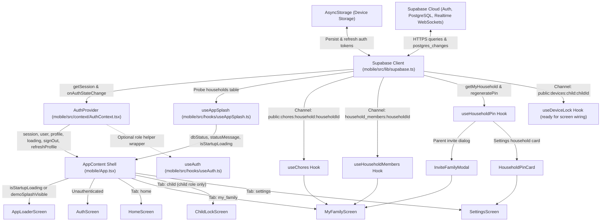

# Chorpy State Management Architecture

> **Scope:** Mobile Client (`mobile/`)  
> **Approach:** Native React State Management (`AuthContext` + Custom Hooks + Local `useState`) backed by Supabase Realtime WebSockets and `AsyncStorage`  
> **Third-Party Store Libraries Installed:** None (verified in `mobile/package.json`)

---

## 1. Executive Overview & Beginner-Friendly Concept Guide

### What Is "State Management"?

In a mobile app, **state** is any data that changes while someone uses the app:
- Who is currently logged in (`user` and `profile`).
- Whether the app is still loading or connected to the backend (`loading`, `dbStatus`).
- Which chores belong to the family (`chores`) and whether a newly created chore is still saving (`pendingIds`).
- Whether a child's device is locked (`lockStatus`).
- Temporary UI choices like which tab is selected (`activeTab`) or whether a popup dialog is open (`isInviteModalOpen`).

Instead of dumping all of this data into one giant global container, Chorpy separates state into **five clear layers** based on how widely the data is needed and how long it needs to survive.

### How Chorpy Manages State Today

Chorpy uses **native React state management**—specifically **React Context**, **custom React hooks**, and **screen-local `useState`**—paired with **`@react-native-async-storage/async-storage`** for login persistence and **`@supabase/supabase-js` Realtime channels** for live database synchronization.

As verified in `mobile/package.json`, Chorpy intentionally installs **zero third-party state libraries** (no Redux, Zustand, MobX, or TanStack Query). For a focused household chore app with a small number of screens, native React primitives keep the architecture lightweight, type-safe, and easy to follow.

| State Layer | Plain-English Purpose | Primary Location(s) | Lifetime |
| :--- | :--- | :--- | :--- |
| **1. Session Persistence** | Keeps the user signed in across app restarts | `mobile/src/lib/supabase.ts` | Persisted on device (`AsyncStorage`) |
| **2. Global Auth Context** | Shares login session and user profile with every screen | `mobile/src/context/AuthContext.tsx`, `mobile/src/hooks/useAuth.ts` | Entire authenticated app lifecycle |
| **3. App Shell & Startup** | Controls startup splash, demo role, and RBAC navigation tabs | `mobile/App.tsx`, `mobile/src/hooks/useAppSplash.ts` | Root app lifecycle |
| **4. Feature Hooks + Realtime** | Loads chores, members, PIN countdowns, and lock status live | `mobile/src/hooks/useChores.ts`, `useHouseholdMembers.ts`, `useHouseholdPin.ts`, `useDeviceLock.ts` | While the host screen/modal is mounted |
| **5. Screen-Local UI State** | Tracks tabs, modals, and form toggles inside one screen | `mobile/src/screens/MyFamilyScreen.tsx`, `SettingsScreen.tsx` | While that screen is active |

---

## 2. State & Data Flow Architecture

The diagram below shows how persisted tokens, Supabase cloud queries, and Realtime WebSocket events flow through `AuthContext`, `AppContent`, and feature hooks into Chorpy's screens.

---

## 3. Active State Management Inventory

### Layer 1: Session Persistence (`mobile/src/lib/supabase.ts`)

**What it does & why we use it:**  
Without device storage, closing and reopening Chorpy would force parents and children to log in every single time. By passing `AsyncStorage` into the Supabase client, login tokens are saved safely on the phone and refreshed automatically in the background.

**Verified implementation details:**
- **File:** `mobile/src/lib/supabase.ts`
- **Storage adapter:** `AsyncStorage` (`@react-native-async-storage/async-storage` `2.2.0`)
- **Environment variables:** `EXPO_PUBLIC_SUPABASE_URL` (trailing slashes and `/rest/v1` normalized) and `EXPO_PUBLIC_SUPABASE_ANON_KEY`
- **Client `auth` configuration:**
  - `storage: AsyncStorage`
  - `autoRefreshToken: true`
  - `persistSession: true`
  - `detectSessionInUrl: false` (standard setting for React Native apps without browser URL callbacks)

---

### Layer 2: Global Auth & Profile Context (`mobile/src/context/AuthContext.tsx` & `mobile/src/hooks/useAuth.ts`)

**What it does & why we use it:**  
Almost every screen needs to know *who* is using the app and *which household* they belong to. Passing `user` and `profile` down as props through every component ("prop drilling") gets messy quickly. React Context creates one shared auth broadcast at the top of the app so any screen can read the current user with `useAuthContext()`.

**Verified implementation details (`mobile/src/context/AuthContext.tsx`):**
- **Provider & Consumer:** `AuthProvider` wraps `<AppContent />` in `mobile/App.tsx`; screens read state via `useAuthContext()`.
- **Context fields (`AuthContextType`):**
  - `session: Session | null`
  - `user: User | null`
  - `profile: Profile | null` (fetched via `authService.getCurrentProfile()`)
  - `loading: boolean` (starts as `true`)
  - `signOut: () => Promise<void>` (calls `authService.signOut()` and clears `session`, `user`, and `profile`)
  - `refreshProfile: () => Promise<void>` (re-runs `loadProfile()`, used by `OnboardingScreen.tsx` after joining/creating a household)
- **Resilience & lifecycle safeguards:**
  - **6000ms safety timeout:** A `setTimeout(..., 6000)` ensures `loading` never remains stuck forever if mobile network latency or a stalled session check prevents `getSession()` from resolving promptly.
  - **Live auth subscription:** Subscribes to `supabase.auth.onAuthStateChange` and cleans up both the timeout and `subscription.unsubscribe()` on unmount using an `isMounted` guard.

**Helper Wrapper (`mobile/src/hooks/useAuth.ts`):**
- Wraps `useAuthContext()` and adds convenience booleans:
  - `isParent`: `context.profile?.role === 'parent'`
  - `isChild`: `context.profile?.role === 'child'`
  - `isAuthenticated`: `!!context.session`
- *Current codebase note:* Existing screens (`App.tsx`, `MyFamilyScreen.tsx`, `OnboardingScreen.tsx`, `SettingsScreen.tsx`) currently call `useAuthContext()` directly, while `useAuth()` provides an ergonomic wrapper ready for components that only need role booleans.

---

### Layer 3: App Shell, Startup Splash & RBAC Navigation (`mobile/App.tsx` & `mobile/src/hooks/useAppSplash.ts`)

**What it does & why we use it:**  
When Chorpy opens, it needs to wait for fonts, check whether the user is signed in, verify that Supabase is reachable, and decide which navigation tabs the user is allowed to see based on their role (`parent` vs `child`). Keeping this coordination in `App.tsx` and `useAppSplash.ts` prevents screens from flashing briefly before authentication or role checks finish.

**Verified implementation details (`mobile/src/hooks/useAppSplash.ts`):**
- **Hook signature:** `useAppSplash(authLoading: boolean): AppSplashState`
- **State & derived fields:**
  - `dbStatus`: `'checking' | 'connected' | 'error'` (probes `supabase.from('households').select('count', { count: 'exact', head: true })`)
  - `statusMessage`: Human-readable connection message (starts as `'Connecting to Supabase...'`)
  - `isStartupLoading`: `authLoading || dbStatus === 'checking'`
  - `retryConnection()`: Re-runs the Supabase probe on demand
- **Temporary testing state (`TODO(remove-after-testing)`):**
  - `demoSplashVisible`, `demoStatusText`, `triggerDemoSplash`, `dismissDemoSplash` allow previewing the flying Chorpy splash screen and measuring live Supabase response time (`demoRequestIdRef` cancels stale responses if dismissed early).

**Verified implementation details (`mobile/App.tsx`):**
- **Root font gate (`App`):** Loads Fredoka and Poppins fonts via `useFonts(...)` and hides the native Expo splash screen (`SplashScreen.hideAsync()`) once `appReady` is true.
- **Navigation & Role State (`AppContent`):**
  - `currentScreen`: `'home' | 'my_family' | 'child' | 'settings'`
  - `demoRole`: `'parent' | 'child' | null` (supports `onDemoLogin` from `AuthScreen` and is cleared on `handleSignOut`)
  - `effectiveRole`: `profile?.role || demoRole || 'parent'`
- **Role-Based Access Control (RBAC) guards:**
  - `PARENT_NAV_TABS`: `home`, `my_family`, `settings`
  - `CHILD_NAV_TABS`: `home`, `my_family`, `child`, `settings`
  - Active `useEffect` route guard resets `currentScreen` to `'home'` if `effectiveRole` switches to a role that cannot access the active tab, plus conditional rendering checks (`currentScreen === 'child' && effectiveRole === 'child'`).

---

### Layer 4: Feature Hooks & Supabase Realtime Sync

Feature hooks encapsulate data fetching, loading/error states, optimistic UI updates, and live WebSocket subscriptions so UI screens stay clean and focused on rendering.

#### 4A. Household Chores (`mobile/src/hooks/useChores.ts`)

**What it does & why we use it:**  
Parents and children need to see new chores and status updates immediately without pulling to refresh. `useChores` loads chores for the household, listens to Supabase Realtime database changes, and performs **optimistic updates**—showing a newly added chore in the list right away while the server request finishes in the background.

**Verified implementation details:**
- **Hook signature:** `useChores(householdId?: string | null)`
- **State fields:**
  - `chores: Chore[]`
  - `loading: boolean`
  - `error: string | null`
  - `pendingIds: Record<string, boolean>` (tracks temporary optimistic IDs currently saving)
  - `mutationError: string | null` (error banner state if creating a chore fails)
  - `isPartial: boolean` (`Object.keys(pendingIds).length > 0 || (Boolean(error) && chores.length > 0)`)
- **Actions:** `refetch`, `createChoreOptimistic(params)`, `clearMutationError()`
- **Optimistic update & rollback flow (`createChoreOptimistic`):**
  1. Generates a temporary ID matching `` `temp-${Date.now()}-${Math.random().toString(36).slice(2, 7)}` `` and inserts an optimistic `Chore` (`status: 'pending'`) at the top of `chores`, while marking `pendingIds[tempId] = true`.
  2. Calls `choreService.createChore(params)`.
  3. **On success:** Replaces `tempId` (and deduplicates `created.id` in case the Realtime event arrived first) with the real server record and removes `tempId` from `pendingIds`.
  4. **On failure:** Rolls back by filtering `tempId` out of `chores`, clearing `pendingIds[tempId]`, and setting `mutationError`.
- **Realtime subscription:**
  - Channel name: `` `public:chores:household:${householdId}` ``
  - Event filter: `postgres_changes` with `{ event: '*', schema: 'public', table: 'chores', filter: `household_id=eq.${householdId}` }` -> triggers `fetchChores()`, and removes the channel on cleanup.

#### 4B. Household Members (`mobile/src/hooks/useHouseholdMembers.ts`)

**What it does & why we use it:**  
When assigning a chore to a child or displaying who is in the family circle, the app needs an up-to-date list of household profiles. `useHouseholdMembers` keeps member names and roles synchronized in real time when someone joins or updates their profile.

**Verified implementation details:**
- **Hook signature:** `useHouseholdMembers(householdId?: string | null)`
- **State fields:**
  - `membersState: { householdId: string | null; list: Profile[]; error: string | null }` (stores `householdId` alongside the list so switching households never shows stale members from a previous household)
  - `retrying: boolean`
  - Derived outputs: `members`, `loading` (`Boolean(householdId) && (retrying || membersState.householdId !== householdId)`), `error`, `refetchMembers`
- **Realtime subscription:**
  - Channel name: `` `household_members:${householdId}` ``
  - Event filter: `postgres_changes` with `{ event: '*', schema: 'public', table: 'profiles', filter: `household_id=eq.${householdId}` }` -> calls `refreshQuietly()` without flashing a full-screen spinner if cached members for the same household are already visible.

#### 4C. Household Pairing PIN & Countdown (`mobile/src/hooks/useHouseholdPin.ts`)

**What it does & why we use it:**  
Parents can invite family members using a time-limited pairing PIN. If a phone's local clock is a few minutes fast or slow compared to the server, a naive countdown timer would show the wrong remaining time. `useHouseholdPin` compares the server's `server_now` timestamp with the device clock to keep the countdown accurate.

**Verified implementation details:**
- **Hook signature:** `useHouseholdPin(householdId: string | null, role: UserRole): UseHouseholdPinResult`
- **Where used:** `mobile/src/components/family/InviteFamilyModal.tsx` and `mobile/src/components/settings/HouseholdPinCard.tsx`
- **State fields & outputs:**
  - `snapshot`: `{ fetchedForId: string | null; household: Household | null; serverOffsetMs: number; error: string | null }`
  - `remainingSeconds`: Updated every second by a `setInterval(..., 1000)` when `role === 'parent'` and `activeHousehold?.pin_expires_at` is set
  - `serverOffsetMs`: Calculated as `Date.parse(next.server_now) - Date.now()` inside `applyHouseholdSnapshot` to correct device clock skew
  - Derived flags: `activeHousehold`, `loadError`, `loading`, `hasActivePin`, `isRegenerating`, `isRegenerateDisabled` (`isRegenerating || hasActivePin`)
  - `actionError`, `loadHousehold()`, `handleRegenerate()`, and helper `formatCountdown(totalSeconds)` (`MM:SS`)

#### 4D. Child Device Lock Status (`mobile/src/hooks/useDeviceLock.ts`)

**What it does & why we use it:**  
When a parent approves a child's chore proof, the child's device lock should dissolve immediately over WebSockets without waiting for a manual refresh. `useDeviceLock` fetches the child's device status and listens for live updates to the `devices` table.

**Verified implementation details:**
- **Hook signature:** `useDeviceLock(childId?: string | null)`
- **State fields:**
  - `lockStatus: LockStatus` (defaults to `'unlocked'`)
  - `deviceId: string | null`
  - `loading: boolean` (`Boolean(childId)`)
  - Derived boolean: `isLocked` (`lockStatus === 'locked'`)
- **Realtime subscription:**
  - Channel name: `` `public:devices:child:${childId}` ``
  - Event filter: `postgres_changes` with `{ event: 'UPDATE', schema: 'public', table: 'devices', filter: `child_id=eq.${childId}` }` -> reads `payload.new.lock_status` directly from the WebSocket payload without needing an extra round-trip query.
- *Current integration status:* `useDeviceLock` is implemented and exported in `mobile/src/hooks/useDeviceLock.ts`. `mobile/src/screens/ChildLockScreen.tsx` currently displays static placeholder UI and is not yet wired to `useDeviceLock`.

---

### Layer 5: Screen-Local UI State

**What it does & why we use it:**  
Some state only matters to a single screen—such as which sub-tab is highlighted or whether a modal is open. Keeping that state local inside the screen prevents unrelated parts of the app from re-rendering and ensures modals reset cleanly when leaving a screen.

**Verified examples:**
- **`mobile/src/screens/MyFamilyScreen.tsx`:**
  - Local `useState`: `activeTab` (`'chores' | 'family' | 'calendar'`), `isAddFormOpen` (`boolean`), `isInviteModalOpen` (`boolean`).
  - Derived `useMemo` values: `displayName`, `childMembers`, `memberNameMap` (maps user IDs to display names), and `visibleChores` (shows all household chores for `parent`, or filters `assigned_child_id === userId` for `child`).
- **`mobile/src/screens/SettingsScreen.tsx`:**
  - Local `useState`: `isSigningOut` (`boolean`) to disable the sign-out button and show an `ActivityIndicator` while `signOut()` runs.
- **`mobile/src/screens/HomeScreen.tsx`:**
  - Stateless dashboard view receiving `role`, `dbStatus`, `statusMessage`, and `onNavigateToFamily` as props from `AppContent`.

---

## 4. Current Strengths & Known Limitations

### Strengths

1. **Zero extra store boilerplate or bundle weight:** Everything runs on React 19.3 + Supabase SDK primitives already installed in `mobile/package.json`.
2. **Real-time synchronization where it matters:** `useChores`, `useHouseholdMembers`, and `useDeviceLock` subscribe to filtered `postgres_changes` channels so updates propagate immediately across devices.
3. **Resilient UX under poor networks:**
   - `AuthContext` guards startup with a `6000ms` timeout.
   - `useChores` supports optimistic creation (`temp-*`) with automatic rollback and error banners (`mutationError`).
   - `useHouseholdPin` compensates for client clock skew via `server_now`.
   - `useHouseholdMembers` keys cached state by `householdId` so switching households never flashes stale data.
4. **Consistent five-state UI handling:** Screens and components handle **Empty, Loading, Error, Partial, and Populated** states (for example, `isPartial` in `useChores` and split `loadError` vs `actionError` in `InviteFamilyModal`).

### Known Limitations

1. **Tab unmount/remount scope for feature hooks:** Because `App.tsx` switches screens via conditional rendering (`{currentScreen === 'my_family' && <MyFamilyScreen ... />}`), navigating from `MyFamilyScreen` to `HomeScreen` unmounts `MyFamilyScreen`. That tears down the `useChores` and `useHouseholdMembers` Realtime channels and requires a fresh fetch when returning to `MyFamilyScreen`.
2. **No shared cross-screen cache for dashboard summaries:** `HomeScreen` cannot currently display live pending chore counts or household member badges without either calling the hooks again or lifting data into a shared context/store.
3. **Duplicate hook instances for `useHouseholdPin`:** Both `InviteFamilyModal.tsx` and `HouseholdPinCard.tsx` call `useHouseholdPin` independently when mounted, rather than reading from one shared household snapshot.
4. **Placeholder wiring on `ChildLockScreen`:** `ChildLockScreen.tsx` still renders static placeholder text instead of consuming `useDeviceLock` and `useChores`.
5. **No offline mutation queue:** Optimistic chore creation rolls back immediately if the device is offline; failed writes are not queued in `AsyncStorage` for automatic background retry later.

---

## 5. Future State Management Options (May or May Not Add)

Chorpy does **not** need a third-party state library right now. Native React Context and custom hooks are sufficient for the current screen count and feature scope. However, if the app grows—for example, adding live chore counters on `HomeScreen`, persistent background lock state, or offline chore proof retries—the team can evaluate the options below.

| Option | Plain-English Summary | Best Fit / Trigger to Adopt | Trade-Offs |
| :--- | :--- | :--- | :--- |
| **Option A: Keep Current Context + Custom Hooks** *(Status Quo)* | Continue using `AuthContext`, feature hooks (`useChores`, `useDeviceLock`, etc.), and screen `useState` (optionally lifting one `HouseholdProvider` if `HomeScreen` needs summary counts). | Screen count stays small, tab re-fetches remain fast, and offline queueing is not required. | Cross-screen sharing requires lifting extra React Context providers, which can cause wider re-renders if poorly split. |
| **Option B: Possibly Add Zustand** *(Lightweight Global Store)* | A tiny, hook-based global store (`create(...)`) where multiple screens read slices of shared client state (e.g., `chores`, `members`, `lockStatus`) without wrapping everything in nested Context providers. | `HomeScreen`, `MyFamilyScreen`, `ChildLockScreen`, and background lock services all need instant access to the same live data without re-fetching on every tab switch. | Adds one small dependency; requires keeping store updates disciplined so server sync and UI state stay clearly separated. |
| **Option C: Possibly Add Server-Cache / Offline Queue (e.g., TanStack Query)** | A dedicated server-state manager that handles caching, request deduplication, stale-while-revalidate refreshes, and retry/offline mutation queues automatically. | Chorpy adds many paginated/filtered API endpoints, needs instant cached tab transitions with background revalidation, or requires queuing chore/proof submissions while offline. | Larger conceptual and dependency footprint; overlaps with custom fetch/loading logic already written in `useChores` and `useHouseholdMembers`. |

### How Chorpy Could Adopt Zustand Later (Without Breaking Screens)

Because Chorpy already isolates data logic inside custom hooks (`useChores`, `useHouseholdMembers`, `useDeviceLock`), screens do not talk to Supabase directly. If the team ever decides to introduce Zustand:
1. Only the internals of the hooks (or a centralized Realtime manager mounted once inside `AppContent`) would change to read/write a Zustand store slice.
2. Screens like `MyFamilyScreen.tsx` and `HomeScreen.tsx` could keep almost identical hook APIs, while gaining instant cached data across tab switches and single-channel WebSocket subscriptions per household.
3. Until that cross-screen sharing becomes a real bottleneck, keeping native React Context + custom hooks avoids unnecessary complexity.
